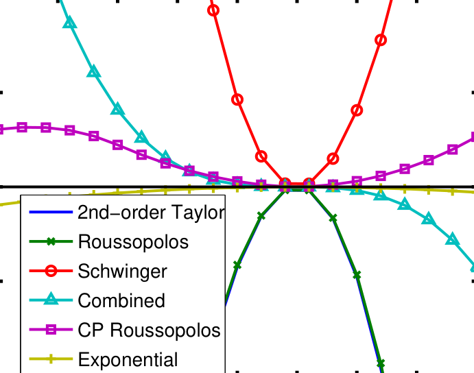

<!-- Generated by build_publications.py; do not edit by hand. -->

```{=html}
<div class="paper-info">

<p class="paper-venue">(2005)</p>
<p class="pub-links"><a href="/assets/papers/2005_ketcheson_lanl_scattering.pdf">Free PDF</a></p>
<div style="clear:both"></div>
</div>
```
