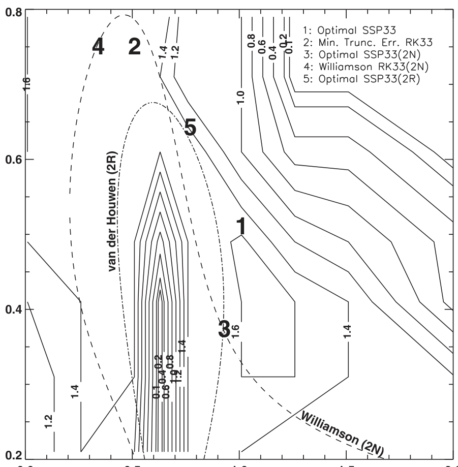

<!-- Generated by build_publications.py; do not edit by hand. -->

```{=html}
<div class="paper-info">

<p class="paper-venue"><span class="pub-journal">International Journal for Numerical Methods in Fluids</span>, 48(3):271--303 (2005)</p>
<p class="pub-links"><a href="https://doi.org/10.1002/fld.837">Published version</a></p>
<div style="clear:both"></div>
</div>
```
