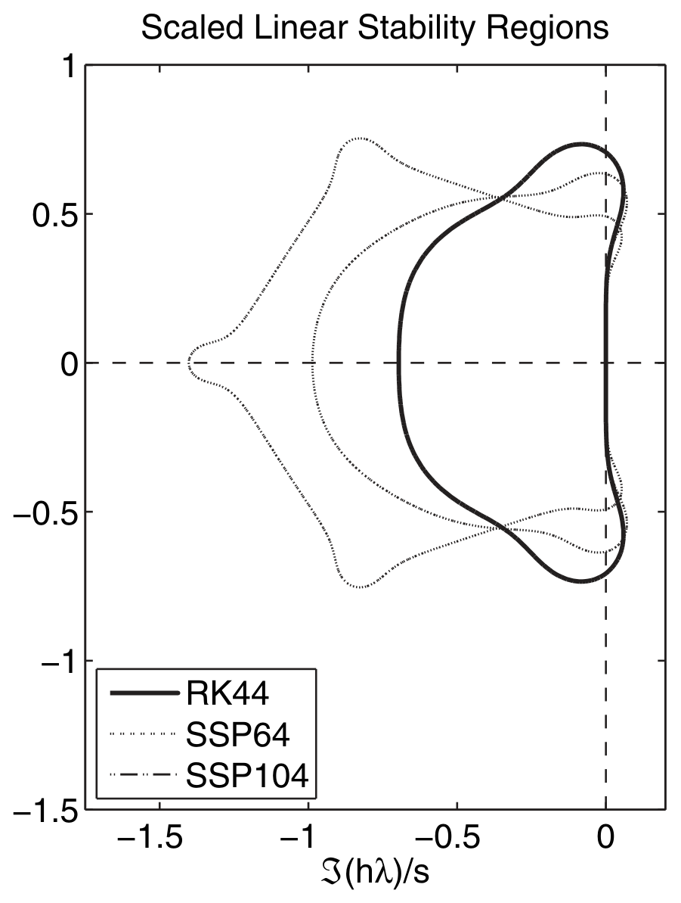

<!-- Generated by build_publications.py; do not edit by hand. -->

```{=html}
<div class="paper-info">

<p class="paper-venue"><span class="pub-journal">SIAM Journal on Scientific Computing</span>, 30(4):2113--2136 (2008)</p>
<p class="pub-links"><a href="/assets/papers/2008_explicit_ssp.pdf">Free PDF</a> | <a href="https://doi.org/10.1137/07070485X">Published version</a></p>
<div style="clear:both"></div>
</div>
```

## Abstract

Strong stability-preserving (SSP) Runge–Kutta methods were developed for time integration of semidiscretizations of partial differential equations. SSP methods preserve stability properties satisfied by forward Euler time integration, under a modified time-step restriction. We consider the problem of finding explicit Runge–Kutta methods with optimal SSP time-step restrictions, first for the case of linear autonomous ordinary differential equations and then for nonlinear or nonautonomous equations. By using alternate formulations of the associated optimization problems and introducing a new, more general class of low-storage implementations of Runge–Kutta methods, new optimal low-storage methods and new low-storage implementations of known optimal methods are found. The results include families of low-storage second and third order methods that achieve the maximum theoretically achievable effective SSP coefficient (independent of stage number), as well as low-storage fourth order methods that are more efficient than current full-storage methods. The theoretical properties of these methods are confirmed by numerical experiment.

<p class="abstract-source">Abstract from the publisher's metadata (via Crossref).</p>
