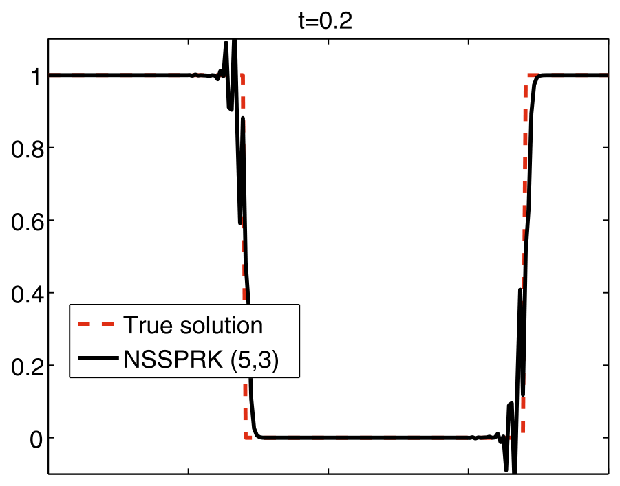

<!-- Generated by build_publications.py; do not edit by hand. -->

```{=html}
<div class="paper-info">

<p class="paper-venue"><span class="pub-journal">Journal of Scientific Computing</span>, 38(3):251--289 (2009)</p>
<p class="pub-links"><a href="http://www.springerlink.com/index/10.1007/s10915-008-9239-z">Paper</a> | <a href="https://doi.org/10.1007/s10915-008-9239-z">Published version</a> | <a href="/assets/papers/sspreview.pdf">Post-print</a></p>
<div style="clear:both"></div>
</div>
```

## Abstract

Strong stability preserving (SSP) high order time discretizations were developed to ensure nonlinear stability properties necessary in the numerical solution of hyperbolic par- tial differential equations with discontinuous solutions. SSP methods preserve the strong sta- bility properties—in any norm, seminorm or convex functional—of the spatial discretization coupled with first order Euler time stepping. This paper describes the development of SSP methods and the connections between the timestep restrictions for strong stability preserva- tion and contractivity. Numerical examples demonstrate that common linearly stable but not strong stability preserving time discretizations may lead to violation of important bounded- ness properties, whereas SSP methods guarantee the desired properties provided only that these properties are satisfied with forward Euler timestepping. We review optimal explicit and implicit SSP Runge–Kutta and multistep methods, for linear and nonlinear problems. We also discuss the SSP properties of spectral deferred correction methods.
