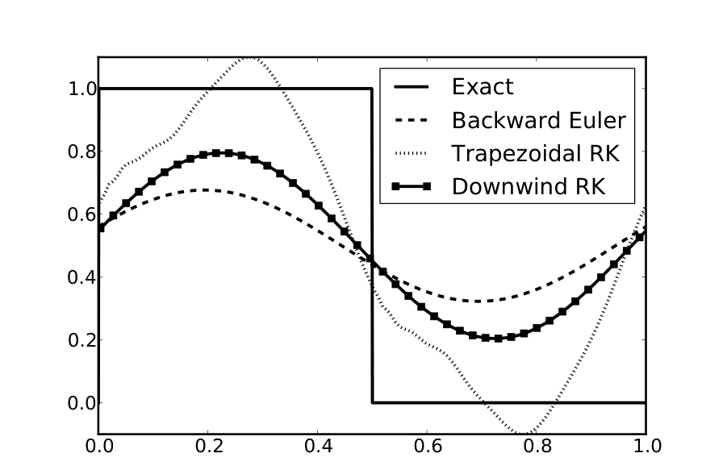

<!-- Generated by build_publications.py; do not edit by hand. -->

```{=html}
<div class="paper-info">

<p class="paper-venue"><span class="pub-journal">SIAM Journal on Numerical Analysis</span>, 49(4):1649 (2011)</p>
<p class="pub-links"><a href="https://doi.org/10.1137/100818674">Published version</a> | <a href="https://arxiv.org/abs/1105.5798">arXiv version</a> | <a href="https://github.com/ketch/downwind_IRK_RR">Reproducibility repository</a></p>
<div style="clear:both"></div>
</div>
```

## Abstract

Strong stability preserving (SSP) integrators for initial value ODEs preserve temporal monotonicity solution properties in arbitrary norms. All existing SSP methods, including implicit methods, either require small step sizes or achieve only first order accuracy. It is possible to achieve more relaxed step size restrictions in the discretization of hyperbolic PDEs through the use of both upwind- and downwind-biased semi-discretizations. We investigate bounds on the maximum SSP step size for methods that include negative coefficients and downwind-biased semi-discretizations. We prove that the downwind SSP coefficient for linear multistep methods of order greater than one is at most equal to two, while the downwind SSP coefficient for explicit Runge–Kutta methods is at most equal to the number of stages of the method. In contrast, the maximal downwind SSP coefficient for second order Runge–Kutta methods is shown to be unbounded. We present a class of such methods with arbitrarily large SSP coefficient and demonstrate that they achieve second order accuracy for large CFL number.

## Code and data

Reproducibility repository: <http://github.com/ketch/downwind_IRK_RR>
