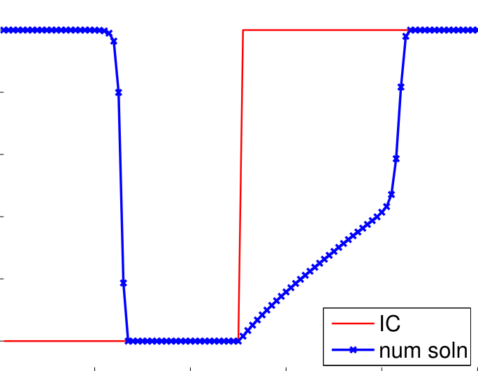

<!-- Generated by build_publications.py; do not edit by hand. -->

```{=html}
<div class="paper-info">

<p class="paper-venue"><span class="pub-journal">SIAM Journal on Numerical Analysis</span>, 49(6):2618-2639 (2011)</p>
<p class="pub-links"><a href="/assets/papers/2011_tsrk.pdf">Free PDF</a> | <a href="https://doi.org/10.1137/10080960X">Published version</a> | <a href="https://arxiv.org/abs/1106.3626">arXiv version</a></p>
<div style="clear:both"></div>
</div>
```

## Abstract

We investigate the strong stability preserving (SSP) property of two-step Runge-Kutta (TSRK) methods. We prove that all SSP TSRK methods belong to a particularly simple subclass of TSRK methods, in which stages from the previous step are not used. We derive simple order conditions for this subclass. Whereas explicit SSP Runge-Kutta methods have order at most four, we prove that explicit SSP TSRK methods have order at most eight. We present TSRK methods of up to eighth order that were found by numerical search. These methods have larger SSP coefficients than any known methods of the same order of accuracy, and may be implemented in a form with relatively modest storage requirements. The usefulness of the TSRK methods is demonstrated through numerical examples, including integration of very high order WENO discretizations.
