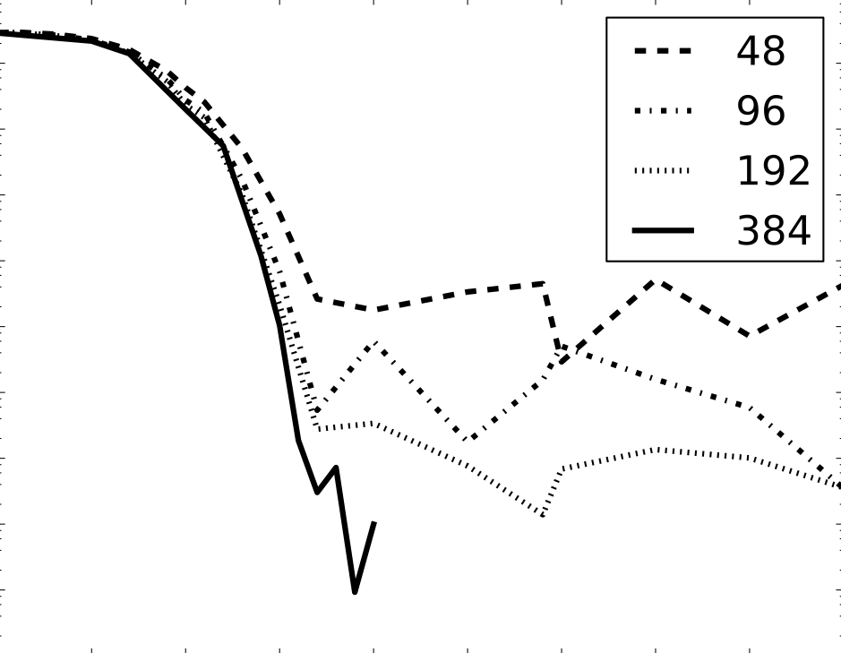

<!-- Generated by build_publications.py; do not edit by hand. -->

```{=html}
<div class="paper-info">

<p class="paper-venue"><span class="pub-journal">Communications in Mathematical Sciences</span>, 10(3):859--874 (2012)</p>
<p class="pub-links"><a href="/assets/papers/2012_ketchesonleveque_periodic.pdf">Free PDF</a> | <a href="https://doi.org/10.4310/CMS.2012.v10.n3.a7">Published version</a> | <a href="https://arxiv.org/abs/1105.2892">arXiv version</a></p>
<div style="clear:both"></div>
</div>
```

## Abstract

Solutions of constant-coefficient nonlinear hyperbolic PDEs generically develop shocks, even if the initial data is smooth. Solutions of hyperbolic PDEs with variable coefficients can behave very differently. We investigate formation and stability of shock waves in a one-dimensional periodic layered medium by computational study of time-reversibility and entropy evolution. We find that periodic layered media tend to inhibit shock formation. For small initial conditions and large impedance variation, no shock formation is detected even after times much greater than the time of shock formation in a homogeneous medium. Furthermore, weak shocks are observed to be dynamically unstable in the sense that they do not lead to significant long-term entropy decay. We propose a characteristic condition for admissibility of shocks in heterogeneous media that generalizes the classical Lax entropy condition and accurately predicts the formation or absence of shocks in these media.

## Code and data

Reproducibility repository: <https://github.com/ketch/layeredmediashocks>
