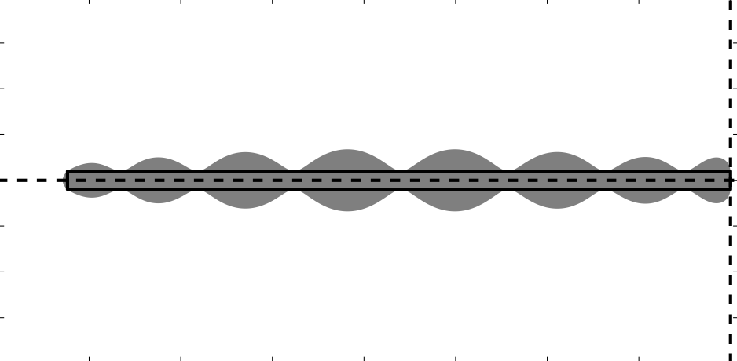

<!-- Generated by build_publications.py; do not edit by hand. -->

```{=html}
<div class="paper-info">

<p class="paper-venue"><span class="pub-journal">Communications in Applied Mathematics and Computational Science</span>, 7(2):247--271 (2012)</p>
<p class="pub-links"><a href="/assets/papers/2012_optimal_stability_polynomials.pdf">Free PDF</a> | <a href="https://doi.org/10.2140/camcos.2012.7.247">Published version</a> | <a href="https://arxiv.org/abs/1201.3035">arXiv version</a> | <a href="https://github.com/ketch/RK-opt">code</a></p>
<div style="clear:both"></div>
</div>
```

## Abstract

We consider the problem of finding optimally stable polynomial approximations to the exponential for application to one-step integration of initial value ordinary and partial differential equations. The objective is to find the largest stable step size and corresponding method for a given problem when the spectrum of the initial value problem is known. The problem is expressed in terms of a general least deviation feasibility problem. Its solution is obtained by a new fast, accurate, and robust algorithm based on convex optimization techniques. Global convergence of the algorithm is proven in the case that the order of approximation is one and in the case that the spectrum encloses a starlike region. Examples demonstrate the effectiveness of the proposed algorithm even when these conditions are not satisfied.
