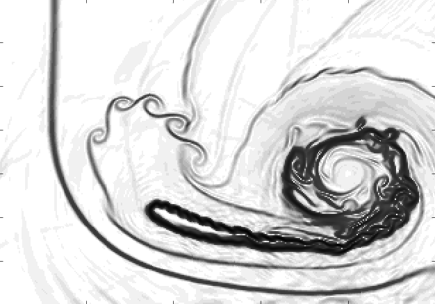

<!-- Generated by build_publications.py; do not edit by hand. -->

```{=html}
<div class="paper-info">

<p class="paper-venue"><span class="pub-journal">SIAM Journal on Scientific Computing</span>, 34(4):C210--C231 (2012)</p>
<p class="pub-links"><a href="/assets/papers/2012_pyclaw-sisc.pdf">Free PDF</a> | <a href="https://doi.org/10.1137/110856976">Published version</a> | <a href="https://arxiv.org/abs/1111.6583">arXiv version</a> | <a href="https://numerics.kaust.edu.sa/papers/pyclaw-sisc/pyclaw-sisc.html">Figures with interactive code</a></p>
<div style="clear:both"></div>
</div>
```

## Abstract

Development of scientific software involves tradeoffs between ease of use, generality, and performance. We describe the design of a general hyperbolic PDE solver that can be operated with the convenience of MATLAB yet achieves efficiency near that of hand-coded Fortran and scales to the largest supercomputers. This is achieved by using Python for most of the code while employing automatically-wrapped Fortran kernels for computationally intensive routines, and using Python bindings to interface with a parallel computing library and other numerical packages. The software described here is PyClaw, a Python-based structured grid solver for general systems of hyperbolic PDEs. PyClaw provides a powerful and intuitive interface to the algorithms of the existing Fortran codes Clawpack and SharpClaw, simplifying code development and use while providing massive parallelism and scalable solvers via the PETSc library. The package is further augmented by use of PyWENO for generation of efficient high-order weighted essentially non-oscillatory reconstruction code. The simplicity, capability, and performance of this approach are demonstrated through application to example problems in shallow water flow, compressible flow and elasticity.

## Code and data

Reproducibility repository: <https://doi.org/10.5281/zenodo.24432819>
