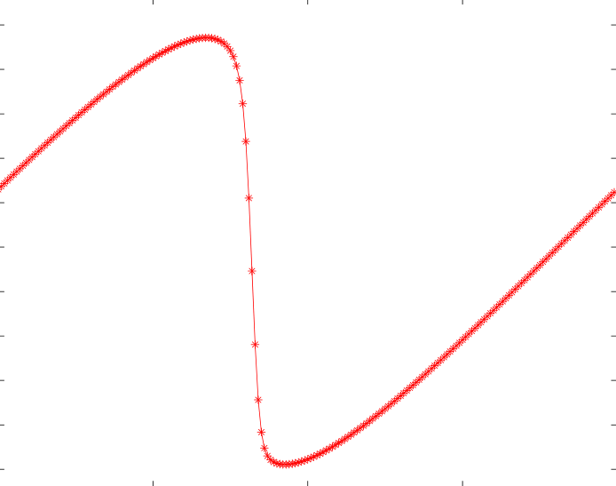

<!-- Generated by build_publications.py; do not edit by hand. -->

```{=html}
<div class="paper-info">

<p class="paper-venue"><span class="pub-journal">SIAM Journal on Numerical Analysis</span>, 51(4):2149--2165 (2013)</p>
<p class="pub-links"><a href="/assets/papers/2013_effective_order_ssp.pdf">Free PDF</a> | <a href="https://doi.org/10.1137/120884201">Published version</a> | <a href="https://arxiv.org/abs/1207.2902">arXiv version</a></p>
<div style="clear:both"></div>
</div>
```

## Abstract

We apply the concept of effective order to strong stability preserving (SSP) explicit Runge–Kutta methods. Relative to classical Runge–Kutta methods, effective order methods are designed to satisfy a relaxed set of order conditions, but yield higher order accuracy when composed with special starting and stopping methods. The relaxed order conditions allow for greater freedom in the design of effective order methods. We show that this allows the construction of four-stage SSP methods with effective order four (such methods cannot have classical order four). However, we also prove that effective order five methods - like classical order five methods - require the use of non-positive weights and so cannot be SSP. By numerical optimization, we construct explicit SSP Runge-Kutta methods up to effective order four and establish the optimality of many of them. Numerical experiments demonstrate the validity of these methods in practice.
