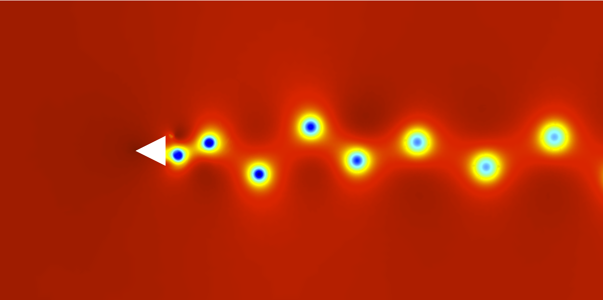

<!-- Generated by build_publications.py; do not edit by hand. -->

```{=html}
<div class="paper-info">

<p class="paper-venue"><span class="pub-journal">SIAM Journal on Scientific Computing</span>, 35(2):A957-A986 (2013)</p>
<p class="pub-links"><a href="/assets/papers/2013_sd_erk.pdf">Free PDF</a> | <a href="https://doi.org/10.1137/120885899">Published version</a> | <a href="https://arxiv.org/abs/1207.5830">arXiv version</a></p>
<div style="clear:both"></div>
</div>
```

## Abstract

Explicit Runge-Kutta schemes with large stable step sizes are developed for integration of high order spectral difference spatial discretization on quadrilateral grids. The new schemes permit an effective time step that is substantially larger than the maximum admissible time step of standard explicit Runge-Kutta schemes available in literature. Furthermore, they have a small principal error norm and admit a low-storage implementation. The advantages of the new schemes are demonstrated through application to the Euler equations and the linearized Euler equations.

## Code and data

Reproducibility repository: <http://github.com/ketch/optimized-erk-sd-rr>
