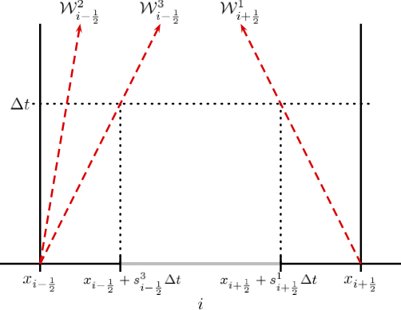

<!-- Generated by build_publications.py; do not edit by hand. -->

```{=html}
<div class="paper-info">

<p class="paper-venue"><span class="pub-journal">SIAM Journal on Scientific Computing</span>, 35(1):A351--A377 (2013)</p>
<p class="pub-links"><a href="/assets/papers/sharpclaw.pdf">Free PDF</a> | <a href="https://doi.org/10.1137/110830320">Published version</a> | <a href="https://arxiv.org/abs/1111.3499">arXiv version</a></p>
<div style="clear:both"></div>
</div>
```

## Abstract

We present a finite volume method that is applicable to general hyperbolic PDEs, including non-conservative and spatially varying systems. The method can be extended to arbitrarily high order of accuracy and allows a well-balanced implementation for capturing solutions of balance laws near steady state. This well-balancing is achieved through the f-wave Riemann solver and a novel wave-slope WENO reconstruction procedure. The spatial discretization, like that of the well-known Clawpack software, is based on solving Riemann problems and calculating fluctuations (not fluxes). Our implementation employs weighted essentially non-oscillatory reconstruction in space and strong stability preserving Runge-Kutta integration in time. We demonstrate the wide applicability and advantageous properties of the method through numerical examples, including problems in non-conservative form, problems with spatially varying fluxes, and problems involving near-equilibrium solutions of balance laws.
