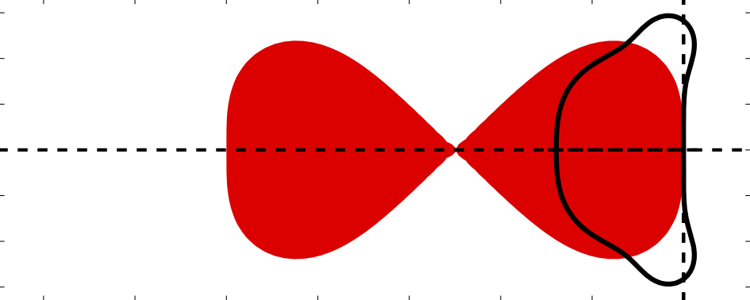

<!-- Generated by build_publications.py; do not edit by hand. -->

```{=html}
<div class="paper-info">

<p class="paper-venue"><span class="pub-journal">SIAM Journal On Numerical Analysis</span>, 51(5):2887-2910 (2013)</p>
<p class="pub-links"><a href="/assets/papers/2013_sperk.pdf">Free PDF</a> | <a href="https://doi.org/10.1137/130906258">Published version</a> | <a href="https://arxiv.org/abs/1301.4006">arXiv version</a></p>
<div style="clear:both"></div>
</div>
```

## Abstract

We study spatially partitioned embedded Runge–Kutta (SPERK) schemes for partial differential equations (PDEs), in which each of the component schemes is applied over a different part of the spatial domain. Such methods may be convenient for problems in which the smoothness of the solution or the magnitudes of the PDE coefficients vary strongly in space. We focus on embedded partitioned methods as they offer greater efficiency and avoid the order reduction that may occur in non-embedded schemes. We demonstrate that the lack of conservation in partitioned schemes can lead to non-physical effects and propose conservative additive schemes based on partitioning the fluxes rather than the ordinary differential equations. A variety of SPERK schemes are presented, including an embedded pair suitable for the time evolution of fifth-order weighted non-oscillatory (WENO) spatial discretizations. Numerical experiments are provided to support the theory.
