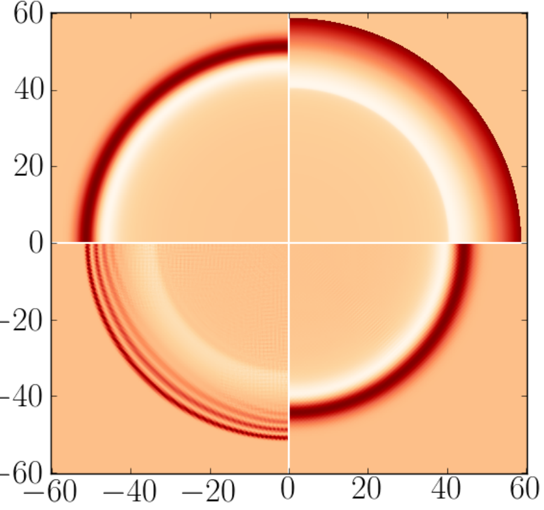

<!-- Generated by build_publications.py; do not edit by hand. -->

```{=html}
<div class="paper-info">

<p class="paper-venue"><span class="pub-journal">Journal of Scientific Computing</span>, 58(3):672-689 (2014)</p>
<p class="pub-links"><a href="https://doi.org/10.1007/s10915-013-9747-3">Published version</a> | <a href="https://arxiv.org/abs/1209.5164">arXiv version</a> | <a href="/assets/papers/2014_cylindrical_solitary_waves_postprint.pdf">Free Postprint</a></p>
<div style="clear:both"></div>
</div>
```

## Abstract

We study the behavior of nonlinear waves in a two-dimensional medium with density and stress relation that vary periodically in space. Efficient approximate Riemann solvers are developed for the corresponding variable-coefficient first-order hyperbolic system. We present direct numerical simulations of this multiscale problem, focused on the propagation of a single localized perturbation in media with strongly varying impedance. For the conditions studied, we find little evidence of shock formation. Instead, solutions consist primarily of solitary waves. These solitary waves are observed to be stable over long times and to interact in a manner approximately like solitons. The system considered has no dispersive terms; these solitary waves arise due to the material heterogeneity, which leads to strong reflections and effective dispersion.
