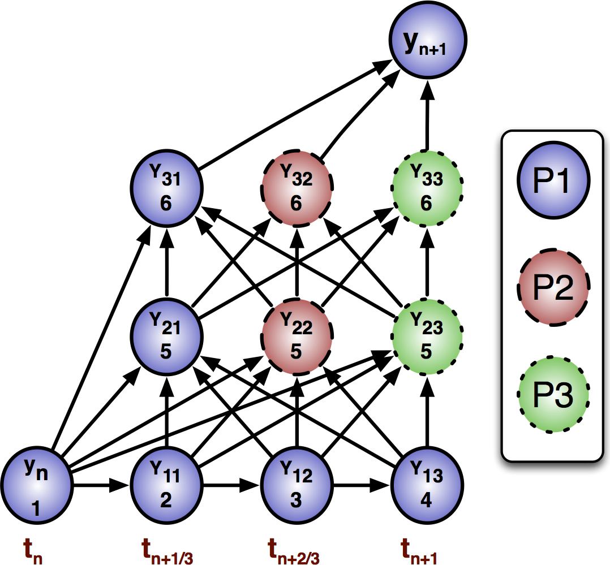

<!-- Generated by build_publications.py; do not edit by hand. -->

```{=html}
<div class="paper-info">

<p class="paper-venue"><span class="pub-journal">CAMCoS</span>, 9(2):175-200 (2014)</p>
<p class="pub-links"><a href="/assets/papers/2014_hork.pdf">Free PDF</a> | <a href="https://doi.org/10.2140/camcos.2014.9.175">Published version</a> | <a href="https://arxiv.org/abs/1305.6165">arXiv version</a></p>
<div style="clear:both"></div>
</div>
```

## Abstract

We compare the three main types of high-order one-step initial value solvers: extrapolation, spectral deferred correction, and embedded Runge–Kutta pairs. We consider orders four through twelve, including both serial and parallel implementations. We cast extrapolation and deferred correction methods as fixed-order Runge–Kutta methods, providing a natural framework for the comparison. The stability and accuracy properties of the methods are analyzed by theoretical measures, and these are compared with the results of numerical tests. In serial, the 8th-order pair of Prince and Dormand (DOP8) is most efficient. But other high order methods can be more efficient than DOP8 when implemented in parallel. This is demonstrated by comparing a parallelized version of the well-known ODEX code with the (serial) DOP853 code. For an $N$-body problem with $N=400$, the experimental extrapolation code is as fast as the tuned Runge–Kutta pair at loose tolerances, and is up to two times as fast at tight tolerances.

<p class="abstract-source">Abstract of the arXiv version, <a href="https://arxiv.org/abs/1305.6165">arXiv:1305.6165</a>.</p>

## Code and data

Reproducibility repository: <https://github.com/ketch/high_order_RK_RR>
