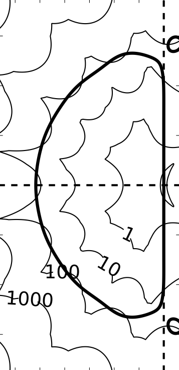

<!-- Generated by build_publications.py; do not edit by hand. -->

```{=html}
<div class="paper-info">

<p class="paper-venue"><span class="pub-journal">SIAM Journal on Numerical Analysis</span>, 52(5):2227--2249 (2014)</p>
<p class="pub-links"><a href="/assets/papers/2014_internal_stability.pdf">Free PDF</a> | <a href="https://doi.org/10.1137/130936245">Published version</a> | <a href="https://arxiv.org/abs/1309.1317">arXiv version</a></p>
<div style="clear:both"></div>
</div>
```

## Abstract

In practical computation with Runge–Kutta methods, the stage equations are not satisfied exactly, due to roundoff errors, algebraic solver errors, and so forth. We show by example that propagation of such errors within a single step can have catastrophic effects for otherwise practical and well-known methods. We perform a general analysis of internal error propagation, emphasizing that it depends significantly on how the method is implemented. We show that for a fixed method, essentially any set of internal stability polynomials can be obtained by modifying the implementation details. We provide bounds on the internal error amplification constants for some classes of methods with many stages, including strong stability preserving methods and extrapolation methods. These results are used to prove error bounds in the presence of roundoff or other internal errors.

<p class="abstract-source">Abstract of the arXiv version, <a href="https://arxiv.org/abs/1309.1317">arXiv:1309.1317</a>.</p>
