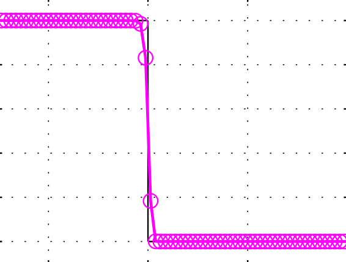

<!-- Generated by build_publications.py; do not edit by hand. -->

```{=html}
<div class="paper-info">

<p class="paper-venue"><span class="pub-journal">Journal of Scientific Computing</span>, 63(3):633--653 (2015)</p>
<p class="pub-links"><a href="https://doi.org/10.1007/s10915-014-9906-1">Published version</a> | <a href="https://arxiv.org/abs/1310.7168">arXiv version</a> | <a href="/assets/papers/2014_partitioned_multirate_postprint.pdf">Free Postprint</a></p>
<div style="clear:both"></div>
</div>
```

## Abstract

An error analysis is presented for explicit partitioned Runge-Kutta methods and multirate methods applied to conservation laws. The interfaces, across which different methods or time steps are used, lead to order reduction of the schemes. Along with cell-based decompositions, also flux-based decompositions are studied. In the latter case mass conservation is guaranteed, but it will be seen that the accuracy may deteriorate.

<p class="abstract-source">Abstract of the arXiv version, <a href="https://arxiv.org/abs/1310.7168">arXiv:1310.7168</a>.</p>
