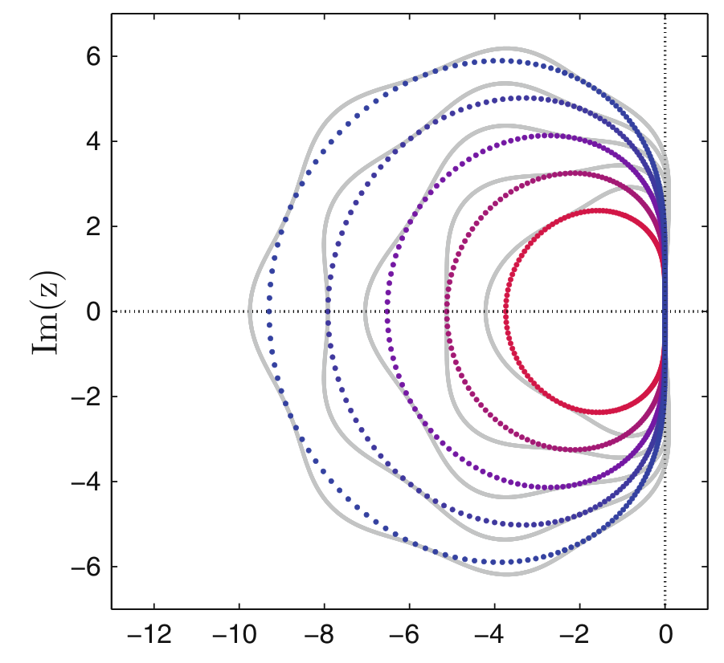

<!-- Generated by build_publications.py; do not edit by hand. -->

```{=html}
<div class="paper-info">

<p class="paper-venue"><span class="pub-journal">Journal of Scientific Computing</span>, 60(2):313-344 (2014)</p>
<p class="pub-links"><a href="https://doi.org/10.1007/s10915-013-9796-7">Published version</a> | <a href="/assets/papers/dg_ssp_stability.pdf">Post-print</a></p>
<div style="clear:both"></div>
</div>
```
