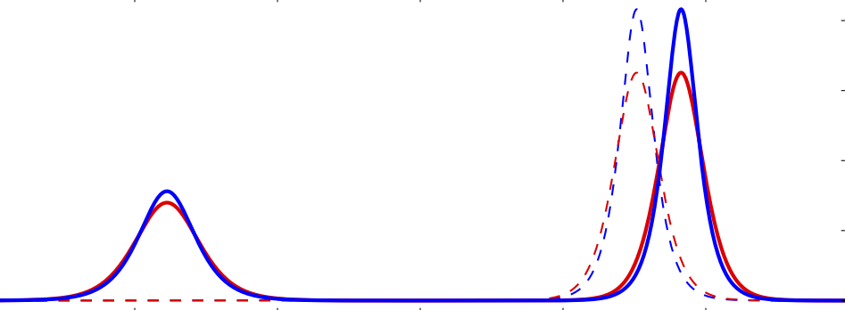

<!-- Generated by build_publications.py; do not edit by hand. -->

```{=html}
<div class="paper-info">

<p class="paper-venue"><span class="pub-journal">Multiscale Modeling & Simulation</span>, 13(1):440--458 (2015)</p>
<p class="pub-links"><a href="https://doi.org/10.1137/130946526">Published version</a> | <a href="https://arxiv.org/abs/1312.4122">arXiv version</a></p>
<div style="clear:both"></div>
</div>
```

## Abstract

A new class of solitary waves arises in the solution of nonlinear wave equations with constant impedance and no dispersive terms. They depend on a balance between nonlinearity and a dispersion-like effect due to spatial variation in the sound speed of the medium. A high-order homogenized model confirms this effective dispersive behavior and its solutions agree well with those obtained by direct simulation of the variable-coefficient system. These waves are observed to be long-time stable, globally attracting solutions that arise in general as solutions to nonlinear wave problems with periodically-varying sound speed. They share some properties with known classes of solitary waves, but possess important differences as well.

<p class="abstract-source">Abstract of the arXiv version, <a href="https://arxiv.org/abs/1312.4122">arXiv:1312.4122</a>.</p>

## Code and data

Reproducibility repository: <https://github.com/ketch/diffractons_RR>
