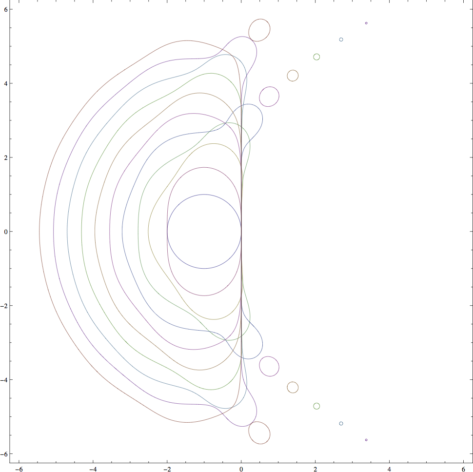

<!-- Generated by build_publications.py; do not edit by hand. -->

```{=html}
<div class="paper-info">

<p class="paper-venue"><span class="pub-journal">IMA Journal of Numerical Analysis</span>, 35(3):1426-1455 (2015)</p>
<p class="pub-links"><a href="https://imajna.oxfordjournals.org/cgi/content/abstract/dru039?ijkey=k8rlLsKUMTuJVk4&keytype=ref">Paper</a> | <a href="https://doi.org/10.1093/imanum/dru039">Published version</a> | <a href="https://arxiv.org/abs/1312.0216">arXiv version</a></p>
<div style="clear:both"></div>
</div>
```

## Abstract

Certain numerical methods for initial value problems have as stability function the nth partial sum of the exponential function. We study the stability region, i.e., the set in the complex plane over which the nth partial sum has at most unit modulus. It is known that the asymptotic shape of the part of the stability region in the left half-plane is a semi-disk. We quantify this by providing disks that enclose or are enclosed by the stability region or its left half-plane part. The radius of the smallest disk centered at the origin that contains the stability region (or its portion in the left half-plane) is determined for $1\le n\le 20$. Bounds on such radii are proved for $n\ge 2$; these bounds are shown to be optimal in the limit $n\to +\infty$. We prove that the stability region and its complement, restricted to the imaginary axis, consist of alternating intervals of length tending to $π$, as $n\to\infty$. Finally, we prove that a semi-disk in the left half-plane with vertical boundary being the imaginary axis and centered at the origin is included in the stability region if and only if $n\equiv 0 \mod 4$ or $n\equiv 3\mod 4$. The maximal radii of such semi-disks are exactly determined for $1\le n\le 20$.

<p class="abstract-source">Abstract of the arXiv version, <a href="https://arxiv.org/abs/1312.0216">arXiv:1312.0216</a>.</p>
