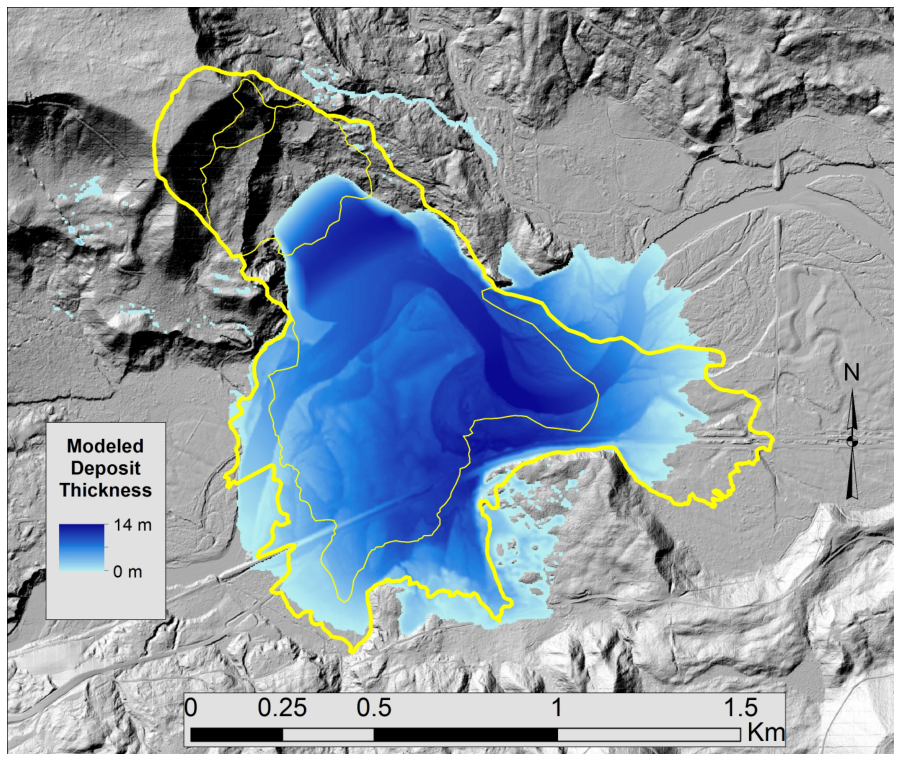

<!-- Generated by build_publications.py; do not edit by hand. -->

```{=html}
<div class="paper-info">

<p class="paper-venue"><span class="pub-journal">PeerJ Computer Science</span>, 2 (2016)</p>
<p class="pub-links"><a href="https://doi.org/10.7717/peerj-cs.68">Published version</a></p>
<div style="clear:both"></div>
</div>
```

## Abstract

Clawpack is a software package designed to solve nonlinear hyperbolic partial differential equations using high-resolution finite volume methods based on Riemann solvers and limiters. The package includes a number of variants aimed at different applications and user communities. Clawpack has been actively developed as an open source project for over 20 years. The latest major release, Clawpack 5, introduces a number of new features and changes to the code base and a new development model based on GitHub and Git submodules. This article provides a summary of the most significant changes, the rationale behind some of these changes, and a description of our current development model.

<p class="abstract-source">Abstract from the publisher's metadata (via Crossref).</p>
