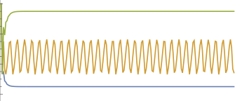

<!-- Generated by build_publications.py; do not edit by hand. -->

```{=html}
<div class="paper-info">

<p class="paper-venue"><span class="pub-journal">SIAM Journal On Numerical Analysis</span>, 54(5):2799-2832 (2016)</p>
<p class="pub-links"><a href="https://doi.org/10.1137/15M101717X">Published version</a> | <a href="https://arxiv.org/abs/1504.04107">arXiv version</a></p>
<div style="clear:both"></div>
</div>
```

## Abstract

Strong stability preserving (SSP) methods are designed primarily for time integration of nonlinear hyperbolic PDEs, for which the permissible SSP step size varies from one step to the next. We develop the first SSP linear multistep methods (of order two and three) with variable step size, and prove their optimality, stability, and convergence. The choice of step size for multistep SSP methods is an interesting problem because the allowable step size depends on the SSP coefficient, which in turn depends on the chosen step sizes. The description of the methods includes an optimal step-size strategy. We prove sharp upper bounds on the allowable step size for explicit SSP linear multistep methods and show the existence of methods with arbitrarily high order of accuracy. The effectiveness of the methods is demonstrated through numerical examples.

<p class="abstract-source">Abstract of the arXiv version, <a href="https://arxiv.org/abs/1504.04107">arXiv:1504.04107</a>.</p>

## Code and data

Reproducibility repository: <https://github.com/numerical-mathematics/ssp-lmm-vss_RR>
