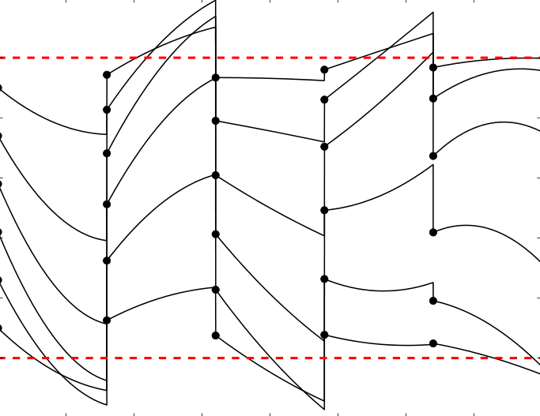

<!-- Generated by build_publications.py; do not edit by hand. -->

```{=html}
<div class="paper-info">

<p class="paper-venue"><span class="pub-journal">Journal of Scientific Computing</span>, 71(3):944--958 (2017)</p>
<p class="pub-links"><a href="https://doi.org/10.1007/s10915-016-0331-5">Published version</a> | <a href="https://arxiv.org/abs/1605.02429">arXiv version</a></p>
<div style="clear:both"></div>
</div>
```

## Abstract

We investigate dense output formulae (also known as continuous extensions) for strong stability preserving (SSP) Runge-Kutta methods. We require that the dense output formula also possess the SSP property, ideally under the same step-size restriction as the method itself. A general recipe for first-order SSP dense output formulae for SSP methods is given, and second-order dense output formulae for several optimal SSP methods are developed. It is shown that SSP dense output formulae of order 3 and higher do not exist, and that in any method possessing a second-order SSP dense output, the coefficient matrix A has a zero row.

<p class="abstract-source">Abstract of the arXiv version, <a href="https://arxiv.org/abs/1605.02429">arXiv:1605.02429</a>.</p>
