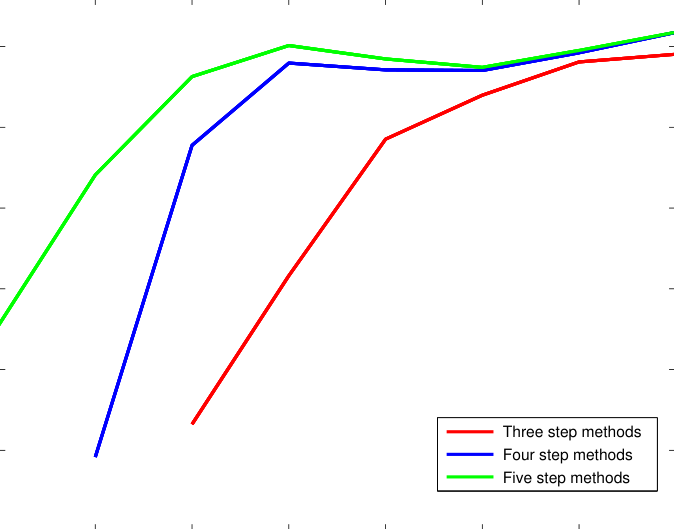

<!-- Generated by build_publications.py; do not edit by hand. -->

```{=html}
<div class="paper-info">

<p class="paper-venue"><span class="pub-journal">Math. of Comp.</span>, 86 (2017)</p>
<p class="pub-links"><a href="https://doi.org/10.1090/mcom/3115">Published version</a> | <a href="https://arxiv.org/abs/1307.8058">arXiv version</a></p>
<div style="clear:both"></div>
</div>
```

## Abstract

High-order spatial discretizations with strong stability properties (such as monotonicity) are desirable for the solution of hyperbolic PDEs. Methods may be compared in terms of the strong stability preserving (SSP) time-step. We prove an upper bound on the SSP coefficient of explicit multistep Runge–Kutta methods of order two and above. Order conditions and monotonicity conditions for such methods are worked out in terms of the method coefficients. Numerical optimization is used to find optimized explicit methods of up to five steps, eight stages, and tenth order. These methods are tested on the advection and Buckley-Leverett equations, and the results for the observed total variation diminishing and positivity preserving time-step are presented.

<p class="abstract-source">Abstract of the arXiv version, <a href="https://arxiv.org/abs/1307.8058">arXiv:1307.8058</a>.</p>
