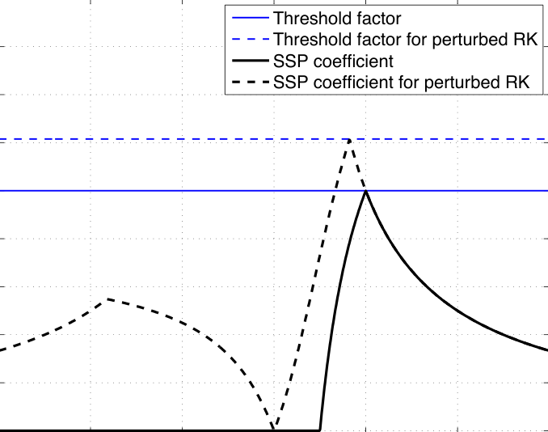

<!-- Generated by build_publications.py; do not edit by hand. -->

```{=html}
<div class="paper-info">

<p class="paper-venue"><span class="pub-journal">Journal of Scientific Computing</span>, 76(3):1337--1369 (2018)</p>
<p class="pub-links"><a href="https://doi.org/10.1007/s10915-018-0664-3">Published version</a> | <a href="https://arxiv.org/abs/1505.04024">arXiv version</a></p>
<div style="clear:both"></div>
</div>
```

## Abstract

Perturbed Runge–Kutta methods (also referred to as downwind Runge–Kutta methods) can guarantee monotonicity preservation under larger step sizes relative to their traditional Runge–Kutta counterparts. In this paper we study the question of how to optimally perturb a given method in order to increase the radius of absolute monotonicity (a.m.). We prove that for methods with zero radius of a.m., it is always possible to give a perturbation with positive radius. We first study methods for linear problems and then methods for nonlinear problems. In each case, we prove upper bounds on the radius of a.m., and provide algorithms to compute optimal perturbations. We also provide optimal perturbations for many known methods.

## Code and data

Reproducibility repository: <https://doi.org/10.5281/zenodo.1146916>
