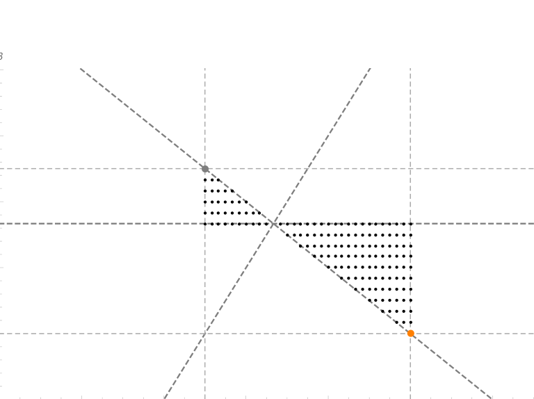

<!-- Generated by build_publications.py; do not edit by hand. -->

```{=html}
<div class="paper-info">

<p class="paper-venue"><span class="pub-journal">Journal of Scientific Computing</span>, 74(1):244--266 (2018)</p>
<p class="pub-links"><a href="https://doi.org/10.1007/s10915-017-0432-9">Published version</a> | <a href="https://arxiv.org/abs/1610.00228">arXiv version</a></p>
<div style="clear:both"></div>
</div>
```

## Abstract

We propose a technique for investigating stability properties like positivity and forward invariance of an interval for method-of-lines discretizations, and apply the technique to study positivity preservation for a class of TVD semi-discretizations of 1D scalar hyperbolic conservation laws. This technique is a generalization of the approach suggested in ref. 12. We give more relaxed conditions on the time-step for positivity preservation for slope-limited semi-discretizations integrated in time with explicit Runge-Kutta methods. We show that the step-size restrictions derived are sharp in a certain sense, and that many higher-order explicit Runge-Kutta methods, including the classical 4th-order method and all non-confluent methods with a negative Butcher coefficient, cannot generally maintain positivity for these semi-discretizations under any positive step size. We also apply the proposed technique to centered finite difference discretizations of scalar hyperbolic and parabolic problems.

<p class="abstract-source">Abstract of the arXiv version, <a href="https://arxiv.org/abs/1610.00228">arXiv:1610.00228</a>.</p>
