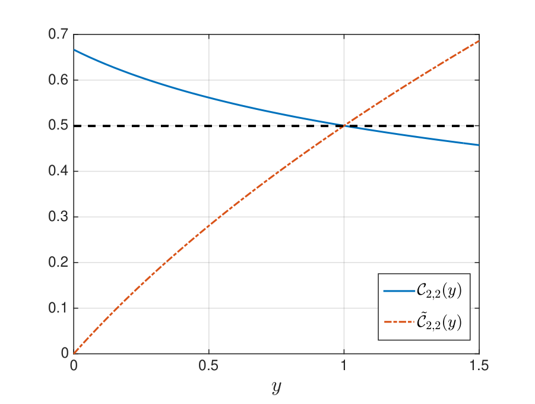

<!-- Generated by build_publications.py; do not edit by hand. -->

```{=html}
<div class="paper-info">

<p class="paper-venue"><span class="pub-journal">Math. of Comp.</span>, 87(313):2295--2320 (2018)</p>
<p class="pub-links"><a href="https://doi.org/10.1090/mcom/3296">Published version</a> | <a href="https://arxiv.org/abs/1601.03637">arXiv version</a></p>
<div style="clear:both"></div>
</div>
```

## Abstract

The analysis of strong-stability-preserving (SSP) linear multistep methods is extended to semi-discretized problems for which different terms on the right-hand side satisfy different forward Euler (or circle) conditions. Optimal additive and perturbed monotonicity-preserving linear multistep methods are studied in the context of such problems. Optimal perturbed methods attain larger monotonicity-preserving step sizes when the different forward Euler conditions are taken into account. On the other hand, we show that optimal SSP additive methods achieve a monotonicity-preserving step-size restriction no better than that of the corresponding non-additive SSP linear multistep methods.

<p class="abstract-source">Abstract of the arXiv version, <a href="https://arxiv.org/abs/1601.03637">arXiv:1601.03637</a>.</p>
