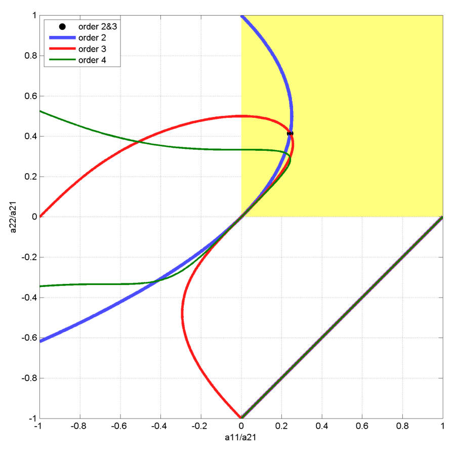

<!-- Generated by build_publications.py; do not edit by hand. -->

```{=html}
<div class="paper-info">

<p class="paper-venue">in Spectral and High Order Methods for Partial Differential Equations ICOSAHOM 2018. (2018)</p>
<p class="pub-links"><a href="https://doi.org/10.1007/978-3-030-39647-3_36">Published version</a> | <a href="https://arxiv.org/abs/1811.01285">arXiv version</a></p>
<div style="clear:both"></div>
</div>
```

## Abstract

Runge-Kutta time-stepping methods in general suffer from order reduction: the observed order of convergence may be less than the formal order when applied to certain stiff problems. Order reduction can be avoided by using methods with high stage order. However, diagonally-implicit Runge-Kutta (DIRK) schemes are limited to low stage order. In this paper we explore a weak stage order criterion, which for initial boundary value problems also serves to avoid order reduction, and which is compatible with a DIRK structure. We provide specific DIRK schemes of weak stage order up to 3, and demonstrate their performance in various examples.

<p class="abstract-source">Abstract of the arXiv version, <a href="https://arxiv.org/abs/1811.01285">arXiv:1811.01285</a>.</p>
