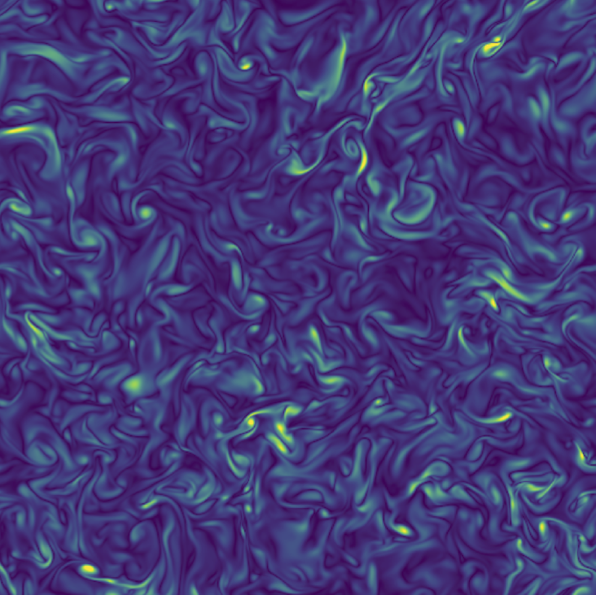

<!-- Generated by build_publications.py; do not edit by hand. -->

```{=html}
<div class="paper-info">

<p class="paper-venue"><span class="pub-journal">International Journal for Numerical Methods in Fluids</span>, 92(2):79--93 (2020)</p>
<p class="pub-links"><a href="https://doi.org/10.1002/fld.4773">Published version</a> | <a href="https://arxiv.org/abs/1810.10197">arXiv version</a></p>
<div style="clear:both"></div>
</div>
```

## Abstract

Time integration of Fourier pseudo-spectral DNS is usually performed using the classical fourth-order accurate Runge–Kutta method, or other methods of second or third order, with a fixed step size. We investigate the use of higher-order Runge-Kutta pairs and automatic step size control based on local error estimation. We find that the fifth-order accurate Runge–Kutta pair of Bogacki & Shampine gives much greater accuracy at a significantly reduced computational cost. Specifically, we demonstrate speedups of 2x-10x for the same accuracy. Numerical tests (including the Taylor-Green vortex, Rayleigh-Taylor instability, and homogeneous isotropic turbulence) confirm the reliability and efficiency of the method. We also show that adaptive time stepping provides a significant computational advantage for some problems (like the development of a Rayleigh-Taylor instability) without compromising accuracy.

<p class="abstract-source">Abstract of the arXiv version, <a href="https://arxiv.org/abs/1810.10197">arXiv:1810.10197</a>.</p>
