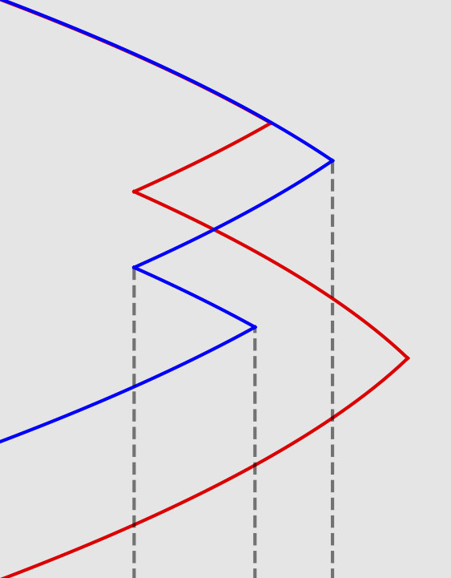

<!-- Generated by build_publications.py; do not edit by hand. -->

```{=html}
<div class="paper-info">

<p class="paper-venue"><span class="pub-journal">SIAM Journal on Applied Mathematics</span>, 79(6):2615--2638 (2019)</p>
<p class="pub-links"><a href="https://doi.org/10.1137/19M1238630">Published version</a> | <a href="https://arxiv.org/abs/1901.04158">arXiv version</a></p>
<div style="clear:both"></div>
</div>
```

## Abstract

A new method of solution is proposed for solution of the wave equation in one space dimension with continuously-varying coefficients. By considering all paths along which information arrives at a given point, the solution is expressed as an infinite series of integrals, where the integrand involves only the initial data and the PDE coefficients. Each term in the series represents the influence of paths with a fixed number of turning points. We prove that the series converges and provide bounds for the truncation error. The effectiveness of the approximation is illustrated with examples. We illustrate an interesting combinatorial connection between the traditional reflection and transmission coefficients for a sharp interface, and Green's coefficient for transmission through a smoothly-varying region.

<p class="abstract-source">Abstract of the arXiv version, <a href="https://arxiv.org/abs/1901.04158">arXiv:1901.04158</a>.</p>

## Code and data

Reproducibility repository: <https://github.com/ketch/characteristics_rr>
