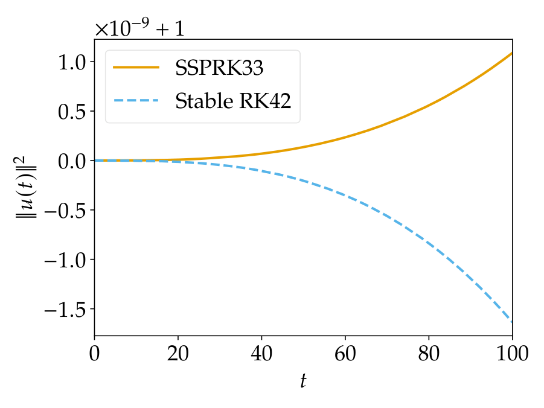

<!-- Generated by build_publications.py; do not edit by hand. -->

```{=html}
<div class="paper-info">

<p class="paper-venue"><span class="pub-journal">SIAM Journal On Numerical Analysis</span>, 58(6):3382--3405 (2020)</p>
<p class="pub-links"><a href="https://doi.org/10.1137/19M1290346">Published version</a> | <a href="https://arxiv.org/abs/1909.13215">arXiv version</a></p>
<div style="clear:both"></div>
</div>
```

## Abstract

Many important initial value problems have the property that energy is non-increasing in time. Energy stable methods, also referred to as strongly stable methods, guarantee the same property discretely. We investigate requirements for conditional energy stability of explicit Runge-Kutta methods for nonlinear or non-autonomous problems. We provide both necessary and sufficient conditions for energy stability over these classes of problems. Examples of conditionally energy stable schemes are constructed and an example is given in which unconditional energy stability is obtained with an explicit scheme.

<p class="abstract-source">Abstract of the arXiv version, <a href="https://arxiv.org/abs/1909.13215">arXiv:1909.13215</a>.</p>

## Code and data

Reproducibility repository: <https://github.com/ranocha/EnergyStabilityExplicitRungeKuttaNonlinearNonautonomous>
