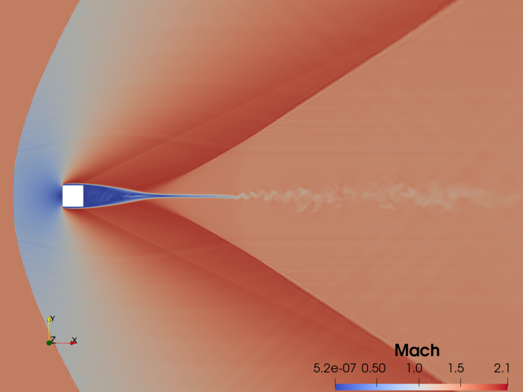

<!-- Generated by build_publications.py; do not edit by hand. -->

```{=html}
<div class="paper-info">

<p class="paper-venue"><span class="pub-journal">SIAM Journal on Scientific Computing</span>, 42(2):A612--A638 (2020)</p>
<p class="pub-links"><a href="https://doi.org/10.1137/19M1263480">Published version</a> | <a href="https://arxiv.org/abs/1905.09129">arXiv version</a></p>
<div style="clear:both"></div>
</div>
```

## Abstract

The framework of inner product norm preserving relaxation Runge-Kutta methods (David I. Ketcheson, *Relaxation Runge-Kutta Methods: Conservation and Stability for Inner-Product Norms*, SIAM Journal on Numerical Analysis, 2019) is extended to general convex quantities. Conservation, dissipation, or other solution properties with respect to any convex functional are enforced by the addition of a *relaxation parameter* that multiplies the Runge-Kutta update at each step. Moreover, other desirable stability (such as strong stability preservation) and efficiency (such as low storage requirements) properties are preserved. The technique can be applied to both explicit and implicit Runge-Kutta methods and requires only a small modification to existing implementations. The computational cost at each step is the solution of one additional scalar algebraic equation for which a good initial guess is available. The effectiveness of this approach is proved analytically and demonstrated in several numerical examples, including applications to high-order entropy-conservative and entropy-stable semi-discretizations on unstructured grids for the compressible Euler and Navier-Stokes equations.

<p class="abstract-source">Abstract of the arXiv version, <a href="https://arxiv.org/abs/1905.09129">arXiv:1905.09129</a>.</p>

## Code and data

Reproducibility repository: <https://github.com/ranocha/ConvexRelaxationRungeKutta>
