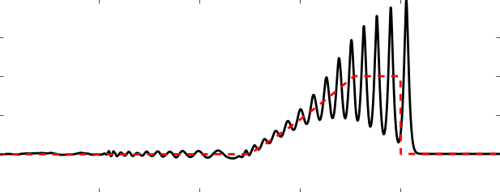

<!-- Generated by build_publications.py; do not edit by hand. -->

```{=html}
<div class="paper-info">

<p class="paper-venue"><span class="pub-journal">Communications in Mathematical Sciences</span>, 18(4):1023--1040 (2020)</p>
<p class="pub-links"><a href="https://doi.org/10.4310/CMS.2020.V18.N4.A6">Published version</a> | <a href="https://arxiv.org/abs/1909.04937">arXiv version</a></p>
<div style="clear:both"></div>
</div>
```

## Abstract

Solutions of first-order nonlinear hyperbolic conservation laws typically develop shocks in finite time even with smooth initial conditions. However, in heterogeneous media with rapid spatial variation, shock formation may be delayed or avoided. When shocks do form in such media, their speed of propagation depends on the material structure. We investigate conditions for shock formation and propagation in heterogeneous media. We focus on the propagation of plane waves in two-dimensional periodic media with material variation in only one direction. We propose an estimate for the speed of the shocks that is based on the Rankine-Hugoniot conditions applied to a leading-order homogenized (constant coefficient) system. We verify this estimate via numerical simulations using different nonlinear constitutive relations and layered and smoothly varying periodic media. In addition, we discuss conditions and regimes under which shocks form in this type of media.

<p class="abstract-source">Abstract of the arXiv version, <a href="https://arxiv.org/abs/1909.04937">arXiv:1909.04937</a>.</p>
