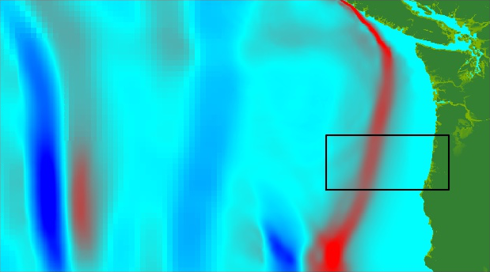

<!-- Generated by build_publications.py; do not edit by hand. -->

```{=html}
<div class="paper-info">

<p class="paper-venue"><span class="pub-journal">Pure and Applied Geophysics</span> (2019)</p>
<p class="pub-links"><a href="https://doi.org/10.1007/s00024-019-02316-y">Published version</a> | <a href="https://arxiv.org/abs/1901.04148">arXiv version</a></p>
<div style="clear:both"></div>
</div>
```

## Abstract

The propagation of long waves onto a continental shelf is of great interest in tsunami modeling and other applications where understanding the amplification of waves during shoaling is important. When the linearized shallow water equations are solved with the continental shelf modeled as a sharp discontinuity, the ratio of the amplitudes is given by the transmission coefficient. On the other hand, when the slope is very broad relative to the wavelength of the incoming wave, then amplification is governed by Green's Law, which predicts a larger amplification than the transmission coefficient, and a much smaller amplitude reflection than given by the reflection coefficient of a sharp interface. We explore the relation between these results and elucidate the behavior in the intermediate case of a very steep continental shelf.

## Code and data

Reproducibility repository: <https://github.com/rjleveque/shoaling_paper_figures>
