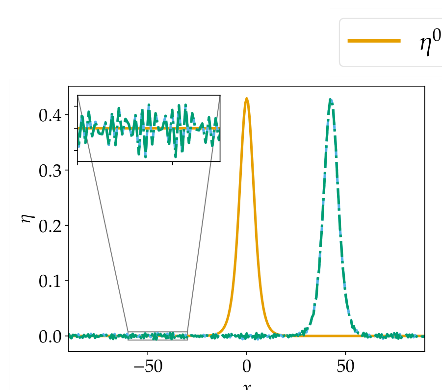

<!-- Generated by build_publications.py; do not edit by hand. -->

```{=html}
<div class="paper-info">

<p class="paper-venue"><span class="pub-journal">Communications in Computational Physics</span>, 29(4):979--1029 (2021)</p>
<p class="pub-links"><a href="https://doi.org/10.4208/CICP.OA-2020-0119">Published version</a> | <a href="https://arxiv.org/abs/2006.14802">arXiv version</a></p>
<div style="clear:both"></div>
</div>
```

## Abstract

We develop a general framework for designing conservative numerical methods based on summation by parts operators and split forms in space, combined with relaxation Runge-Kutta methods in time. We apply this framework to create new classes of fully-discrete conservative methods for several nonlinear dispersive wave equations: Benjamin-Bona-Mahony (BBM), Fornberg-Whitham, Camassa-Holm, Degasperis-Procesi, Holm-Hone, and the BBM-BBM system. These full discretizations conserve all linear invariants and one nonlinear invariant for each system. The spatial semidiscretizations include finite difference, spectral collocation, and both discontinuous and continuous finite element methods. The time discretization is essentially explicit, using relaxation Runge-Kutta methods. We implement some specific schemes from among the derived classes, and demonstrate their favorable properties through numerical tests.

<p class="abstract-source">Abstract of the arXiv version, <a href="https://arxiv.org/abs/2006.14802">arXiv:2006.14802</a>.</p>

## Code and data

Reproducibility repository: <https://github.com/ranocha/Dispersive-wave-schemes-notebooks>
