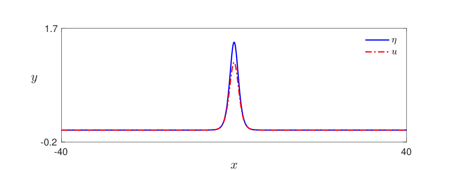

<!-- Generated by build_publications.py; do not edit by hand. -->

```{=html}
<div class="paper-info">

<p class="paper-venue"><span class="pub-journal">SIAM Journal on Scientific Computing</span>, 43(2):B508--B537 (2021)</p>
<p class="pub-links"><a href="https://doi.org/10.1137/20M1364606">Published version</a> | <a href="https://arxiv.org/abs/2009.09641">arXiv version</a></p>
<div style="clear:both"></div>
</div>
```

## Abstract

The paper proposes a new, conservative fully-discrete scheme for the numerical solution of the regularised shallow water Boussinesq system of equations in the cases of periodic and reflective boundary conditions. The particular system is one of a class of equations derived recently and can be used in practical simulations to describe the propagation of weakly nonlinear and weakly dispersive long water waves, such as tsunamis. Studies of small-amplitude long waves usually require long-time simulations in order to investigate scenarios such as the overtaking collision of two solitary waves or the propagation of transoceanic tsunamis. For long-time simulations of non-dissipative waves such as solitary waves, the preservation of the total energy by the numerical method can be crucial in the quality of the approximation. The new conservative fully-discrete method consists of a Galerkin finite element method for spatial semidiscretisation and an explicit relaxation Runge–Kutta scheme for integration in time. The Galerkin method is expressed and implemented in the framework of mixed finite element methods. The paper provides an extended experimental study of the accuracy and convergence properties of the new numerical method. The experiments reveal a new convergence pattern compared to standard Galerkin methods.

<p class="abstract-source">Abstract of the arXiv version, <a href="https://arxiv.org/abs/2009.09641">arXiv:2009.09641</a>.</p>
