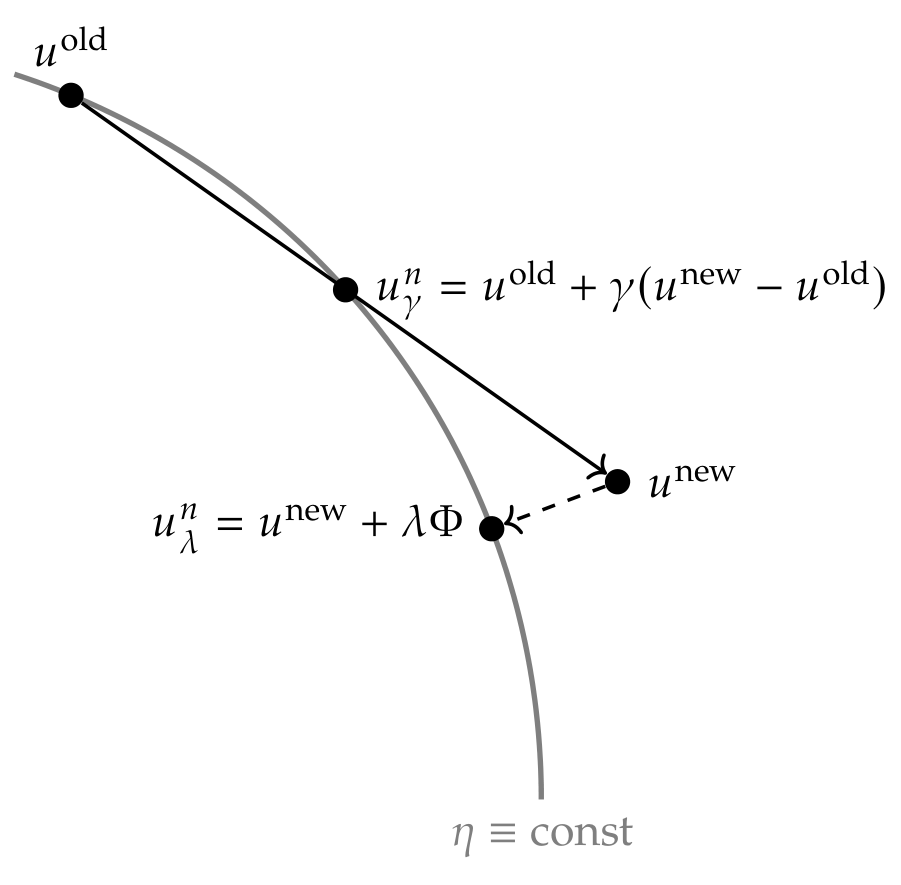

<!-- Generated by build_publications.py; do not edit by hand. -->

```{=html}
<div class="paper-info">

<p class="paper-venue"><span class="pub-journal">Numerische Mathematik</span>, 146 (2020)</p>
<p class="pub-links"><a href="https://doi.org/10.1007/s00211-020-01158-4">Published version</a> | <a href="https://arxiv.org/abs/2003.03012">arXiv version</a></p>
<div style="clear:both"></div>
</div>
```

## Abstract

Recently, an approach known as relaxation has been developed for preserving the correct evolution of a functional in the numerical solution of initial-value problems, using Runge-Kutta methods. We generalize this approach to multistep methods, including all general linear methods of order two or higher, and many other classes of schemes. We prove the existence of a valid relaxation parameter and high-order accuracy of the resulting method, in the context of general equations, including but not limited to conservative or dissipative systems. The theory is illustrated with several numerical examples.

<p class="abstract-source">Abstract of the arXiv version, <a href="https://arxiv.org/abs/2003.03012">arXiv:2003.03012</a>.</p>

## Code and data

Reproducibility repository: <https://github.com/ranocha/Relaxation-LMM-notebooks>
