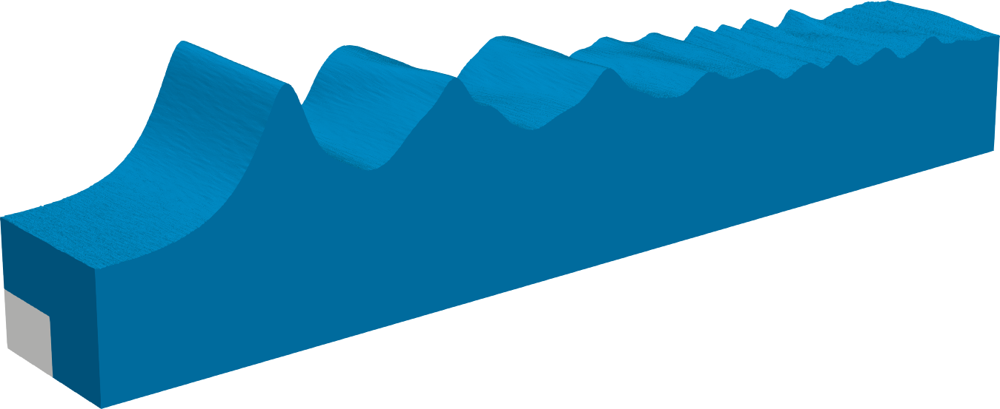

<!-- Generated by build_publications.py; do not edit by hand. -->

```{=html}
<div class="paper-info">

<p class="paper-venue"><span class="pub-journal">Journal of Fluid Mechanics</span>, 917 (2021)</p>
<p class="pub-links"><a href="https://doi.org/10.1017/jfm.2021.267">Published version</a> | <a href="https://arxiv.org/abs/1907.07094">arXiv version</a></p>
<div style="clear:both"></div>
</div>
```

## Abstract

We study the flow of water waves over bathymetry that varies periodically along one direction. We derive a linearized, homogenized model and show that the periodic bathymetry induces an effective dispersion, distinct from the dispersion inherently present in water waves. We relate this dispersion to the well-known effective dispersion introduced by changes in the bathymetry in non-rectangular channels. Numerical simulations using the (non-dispersive) shallow water equations reveal that a balance between this effective dispersion and nonlinearity can create solitary waves. We derive a KdV-type equation that approximates the behavior of these waves in the weakly-nonlinear regime. We show that, depending on geometry, dispersion due to bathymetry can be much stronger than traditional water wave dispersion and can prevent wave breaking in strongly nonlinear regimes. Computational experiments using depth-averaged water wave models

<p class="abstract-source">Abstract of the arXiv version, <a href="https://arxiv.org/abs/1907.07094">arXiv:1907.07094</a>.</p>

## Code and data

Reproducibility repository: <https://github.com/manuel-quezada/water_wave_diffractons_RR>
