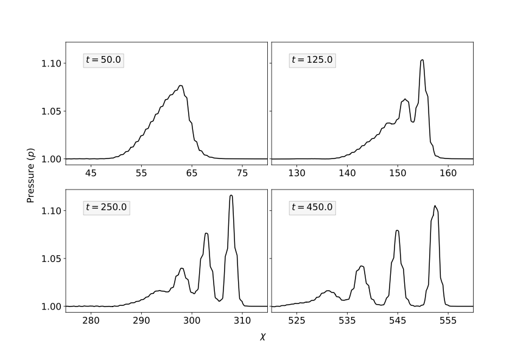

<!-- Generated by build_publications.py; do not edit by hand. -->

```{=html}
<div class="paper-info">

<p class="paper-venue"><span class="pub-journal">Multiscale Modeling & Simulation</span>, 24(1):187--213 (2025)</p>
<p class="pub-links"><a href="https://doi.org/10.1137/24M1712527">Published version</a> | <a href="https://arxiv.org/abs/2412.11086">arXiv version</a></p>
<div style="clear:both"></div>
</div>
```

## Abstract

We study the behavior of perturbations in a compressible one-dimensional inviscid gas with an ambient state consisting of constant pressure and periodically-varying density. We show through asymptotic analysis that long-wavelength perturbations approximately obey a system of dispersive nonlinear wave equations. Computational experiments demonstrate that solutions of the 1D Euler equations agree well with this dispersive model, with solutions consisting mainly of solitary waves. Shock formation seems to be avoided for moderate-amplitude initial data, while shock formation occurs for larger initial data. We investigate the threshold for transition between these behaviors, validating a previously-proposed criterion based on further computational experiments. These results support the existence of large-time non-breaking solutions to the 1D compressible Euler equations, as hypothesized in previous works.

<p class="abstract-source">Abstract of the arXiv version, <a href="https://arxiv.org/abs/2412.11086">arXiv:2412.11086</a>.</p>

## Code and data

Reproducibility repository: <https://github.com/ketch/Euler_1D_homogenization_RR>
