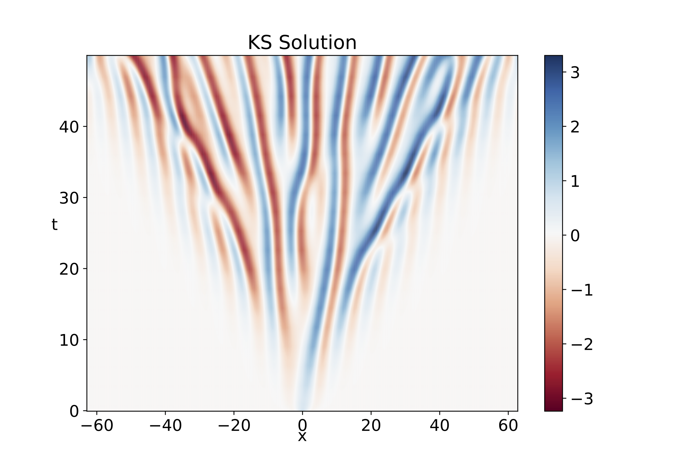

<!-- Generated by build_publications.py; do not edit by hand. -->

```{=html}
<div class="paper-info">

<p class="paper-venue"><span class="pub-journal">Nonlinearity</span>, 38(5):055002 (2025)</p>
<p class="pub-links"><a href="https://doi.org/10.1088/1361-6544/adc6e8">Published version</a> | <a href="https://arxiv.org/abs/2405.16841">arXiv version</a></p>
<div style="clear:both"></div>
</div>
```

## Abstract

We present a framework for constructing a first-order hyperbolic system whose solution approximates that of a desired higher-order evolution equation. Constructions of this kind have received increasing interest in recent years, and are potentially useful as either analytical or computational tools for understanding the corresponding higher-order equation. We perform a systematic analysis of a family of linear model equations and show that for each member of this family there is a stable hyperbolic approximation whose solution converges to that of the model equation in a certain limit. We then show through several examples that this approach can be applied successfully to a very wide range of nonlinear PDEs of practical interest.

<p class="abstract-source">Abstract of the arXiv version, <a href="https://arxiv.org/abs/2405.16841">arXiv:2405.16841</a>.</p>

## Code and data

Reproducibility repository: <https://github.com/ketch/hyperbolization-RR>
