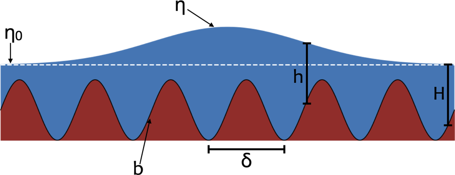

<!-- Generated by build_publications.py; do not edit by hand. -->

```{=html}
<div class="paper-info">

<p class="paper-venue"><span class="pub-journal">Multiscale Modeling & Simulation</span>, 23(1):397--430 (2025)</p>
<p class="pub-links"><a href="https://doi.org/10.1137/23M1614869">Published version</a> | <a href="https://arxiv.org/abs/2311.02603">arXiv version</a></p>
<div style="clear:both"></div>
</div>
```

## Abstract

We study the behavior of shallow water waves over periodically-varying bathymetry, based on the first-order hyperbolic Saint-Venant equations. Although solutions of this system are known to generally exhibit wave breaking, numerical experiments suggest a different behavior in the presence of periodic bathymetry. Starting from the first-order variable-coefficient hyperbolic system, we apply a multiple-scale perturbation approach in order to derive a system of constant-coefficient high-order partial differential equations whose solution approximates that of the original system. The high-order system turns out to be dispersive and exhibits solitary-wave formation, in close agreement with direct numerical simulations of the original system. We show that the constant-coefficient homogenized system can be used to study the properties of solitary waves and to conduct efficient numerical simulations.

<p class="abstract-source">Abstract of the arXiv version, <a href="https://arxiv.org/abs/2311.02603">arXiv:2311.02603</a>.</p>

## Code and data

Reproducibility repository: <https://github.com/ketch/shallow_water_bathymetry_effective_medium_RR>
