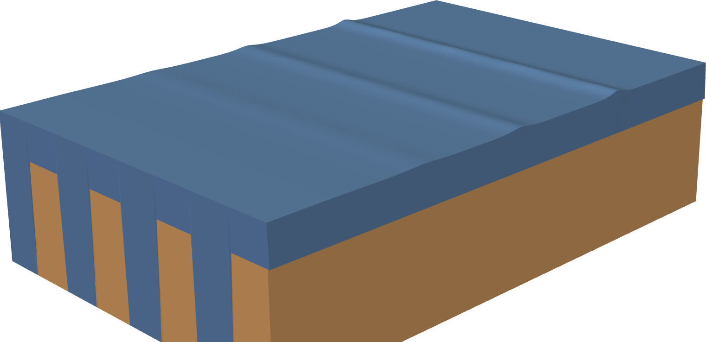

<!-- Generated by build_publications.py; do not edit by hand. -->

```{=html}
<div class="paper-info">

<p class="paper-venue"><span class="pub-journal">Journal of Nonlinear Waves</span>, 1 (2025)</p>
<p class="pub-links"><a href="https://doi.org/10.1017/jnw.2025.1">Published version</a> | <a href="https://arxiv.org/abs/2409.00076">arXiv version</a></p>
<div style="clear:both"></div>
</div>
```

## Abstract

We study the behavior of shallow water waves propagating over bathymetry that varies periodically in one direction and is constant in the other. Plane waves traveling along the constant direction are known to evolve into solitary waves, due to an effective dispersion. We apply multiple-scale perturbation theory to derive an effective constant-coefficient system of equations, showing that the transversely-averaged wave approximately satisfies a Boussinesq-type equation, while the lateral variation in the wave is related to certain integral functions of the bathymetry. Thus the homogenized equations not only accurately describe these waves but also predict their full two-dimensional shape in some detail. Numerical experiments confirm the good agreement between the effective equations and the variable-bathymetry shallow water equations.

<p class="abstract-source">Abstract of the arXiv version, <a href="https://arxiv.org/abs/2409.00076">arXiv:2409.00076</a>.</p>

## Code and data

Reproducibility repository: <https://github.com/ketch/Shallow_water_2D_homogenization_RR>
