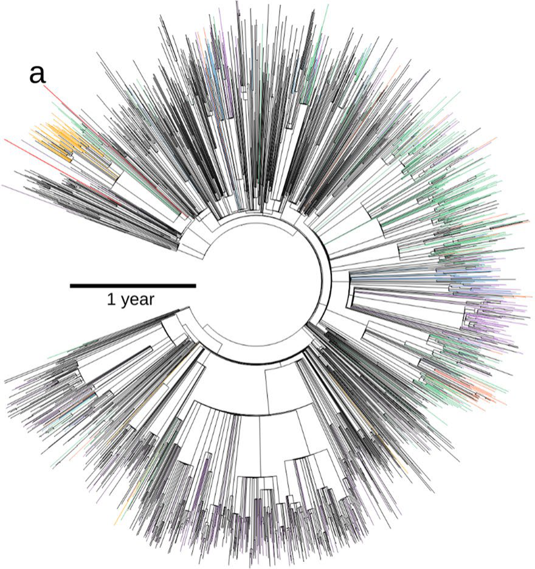

<!-- Generated by build_publications.py; do not edit by hand. -->

```{=html}
<div class="paper-info">

<p class="paper-venue"><span class="pub-journal">Scientific Reports</span>, 12(6457) (2022)</p>
<p class="pub-links"><a href="https://doi.org/10.1038/s41598-022-10097-z">Published version</a></p>
<div style="clear:both"></div>
</div>
```

## Abstract

Evolutionary ecology theory provides an avenue to anticipate the future behavior of SARS-CoV-2. Here we quantify the accelerating evolution of SARS-CoV-2 by tracking the SARS-CoV-2 mutation globally, with a focus on the Receptor Binding Domain (RBD) of the spike protein believed to determine infectivity. We estimate that 384 million people were infected by March 1st, 2021, producing up to 1021 copies of the virus, with one new RBD variant appearing for every 600,000 human infections, resulting in approximately three new effective RBD variants produced daily. Doubling the number of RBD variants every 71.67 days followed by selection of the most infective variants challenges our defenses and calls for a shift to anticipatory, rather than reactive tactics.One-Sentence Summary Accelerating evolution of SARS-CoV-2 demands formulating universal vaccines and treatments based on big-data simulations of possible new variants.Competing Interest StatementThe authors have declared no competing interest.
