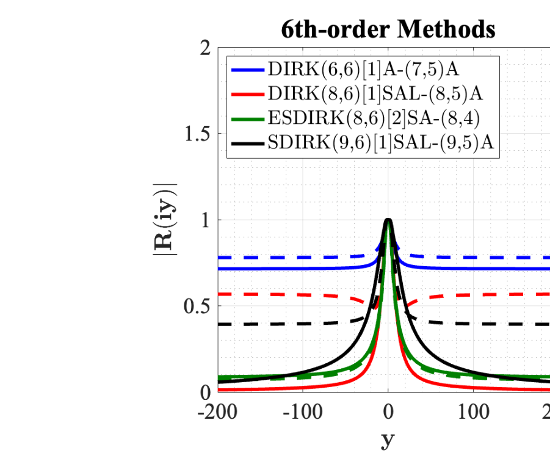

<!-- Generated by build_publications.py; do not edit by hand. -->

```{=html}
<div class="paper-info">

<p class="paper-venue"><span class="pub-journal">Journal of Scientific Computing</span>, 100(3):84 (2024)</p>
<p class="pub-links"><a href="https://doi.org/10.1007/s10915-024-02627-w">Published version</a> | <a href="https://arxiv.org/abs/2211.14574">arXiv version</a></p>
<div style="clear:both"></div>
</div>
```

## Abstract

A numerical search approach is used to design high-order diagonally implicit Runge-Kutta (DIRK) schemes equipped with embedded error estimators, some of which have identical diagonal elements (SDIRK) and explicit first stage (ESDIRK). In each of these classes, we present new A-stable schemes of order six (the highest order of previously known A-stable DIRK-type schemes) up to order eight. For each order, we include one scheme that is only A-stable as well as schemes that are L-stable, stiffly accurate, and/or have stage order two. The latter types require more stages, but give better convergence rates for differential-algebraic equations (DAEs), and those which have stage order two give better accuracy for moderately stiff problems. The development of the eighth-order schemes requires, in addition to imposing A-stability, finding highly accurate numerical solutions for a system of 200 equations in over 100 variables, which is accomplished via a combination of global and local optimization strategies. The accuracy, stability, and adaptive stepsize control of the schemes are demonstrated on diverse problems.

<p class="abstract-source">Abstract of the arXiv version, <a href="https://arxiv.org/abs/2211.14574">arXiv:2211.14574</a>.</p>

## Code and data

Reproducibility repository: <https://github.com/yousefalamri55/High_Order_DIRK_Methods_Coeffs>
