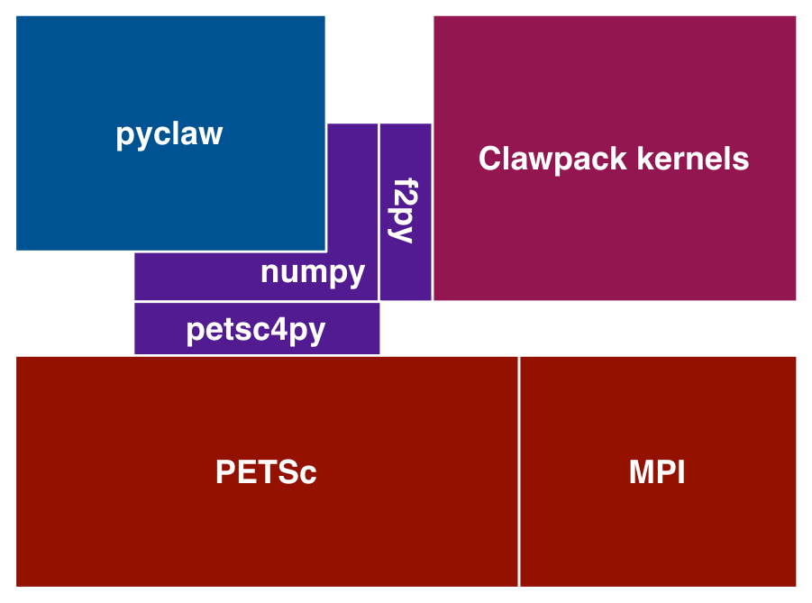

<!-- Generated by build_publications.py; do not edit by hand. -->

```{=html}
<div class="paper-info">

<p class="paper-venue">in Proceedings of SpringSim '11. (2011)</p>
<div style="clear:both"></div>
</div>
```

## Abstract

We present PetClaw, a scalable distributed-memory solver for time-dependent nonlinear wave propagation. PetClaw unifies two well-known scientific computing packages, Clawpack and PETSc, using Python interfaces into both. We rely on Clawpack to provide the infrastructure and kernels for time-dependent nonlinear wave propagation. Similarly, we rely on PETSc to manage distributed data arrays and the communication between them.We describe both the implementation and performance of PetClaw as well as our challenges and accomplishments in scaling a Python-based code to tens of thousands of cores on the BlueGene/P architecture. The capabilities of PetClaw are demonstrated through application to a novel problem involving elastic waves in a heterogeneous medium. Very finely resolved simulations are used to demonstrate the suppression of shock formation in this system.
