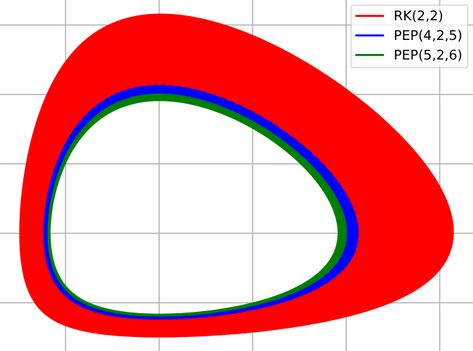

<!-- Generated by build_publications.py; do not edit by hand. -->

```{=html}
<div class="paper-info">

<p class="paper-venue"><span class="pub-journal">ESAIM: Mathematical Modelling and Numerical Analysis</span>, 59(2):729--748 (2025)</p>
<p class="pub-links"><a href="https://doi.org/10.1051/m2an/2025002">Published version</a> | <a href="https://arxiv.org/abs/2407.15365">arXiv version</a></p>
<div style="clear:both"></div>
</div>
```

## Abstract

Using a recent characterization of energy-preserving B-series, we derive the explicit conditions on the coefficients of a Runge-Kutta method that ensure energy preservation (for Hamiltonian systems) up to a given order in the step size, which we refer to as the pseudo-energy-preserving (PEP) order. We study explicit Runge-Kutta methods with PEP order higher than their classical order. We provide examples of such methods up to PEP order six, and test them on Hamiltonian ODE and PDE systems. We find that these methods behave similarly to exactly energy-conservative methods over moderate time intervals and exhibit significantly smaller errors, relative to other Runge-Kutta methods of the same order, for moderately long-time simulations.

<p class="abstract-source">Abstract of the arXiv version, <a href="https://arxiv.org/abs/2407.15365">arXiv:2407.15365</a>.</p>

## Code and data

Reproducibility repository: <https://github.com/Sondar74/PEP_Reproducibility2024>
