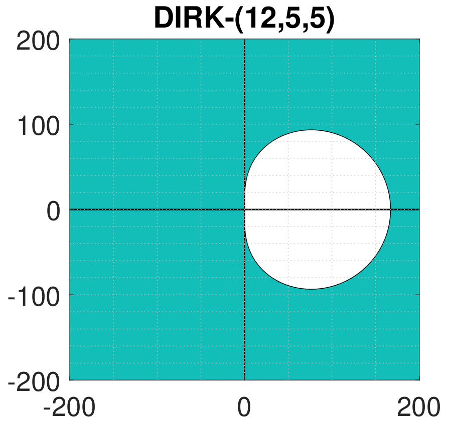

<!-- Generated by build_publications.py; do not edit by hand. -->

```{=html}
<div class="paper-info">

<p class="paper-venue"><span class="pub-journal">Communications in Applied Mathematics and Computational Science</span>, 18(1):1--28 (2023)</p>
<p class="pub-links"><a href="https://doi.org/10.2140/camcos.2023.18.1">Published version</a> | <a href="https://arxiv.org/abs/2204.11264">arXiv version</a></p>
<div style="clear:both"></div>
</div>
```

## Abstract

Runge-Kutta (RK) methods may exhibit order reduction when applied to certain stiff problems. While fully implicit RK schemes exist that avoid order reduction via high-stage order, DIRK (diagonally implicit Runge-Kutta) schemes are practically important due to their structural simplicity; however, these cannot possess high stage order. The concept of weak stage order (WSO) can also overcome order reduction, and it is compatible with the DIRK structure. DIRK schemes of WSO up to 3 have been proposed in the past, however, based on a simplified framework that cannot be extended beyond WSO 3. In this work a general theory of WSO is employed to overcome the prior WSO barrier and to construct practically useful high-order DIRK schemes with WSO 4 and above. The resulting DIRK schemes are stiffly accurate, L-stable, have optimized error coefficients, and are demonstrated to perform well on a portfolio of relevant ODE and PDE test problems.

<p class="abstract-source">Abstract of the arXiv version, <a href="https://arxiv.org/abs/2204.11264">arXiv:2204.11264</a>.</p>
