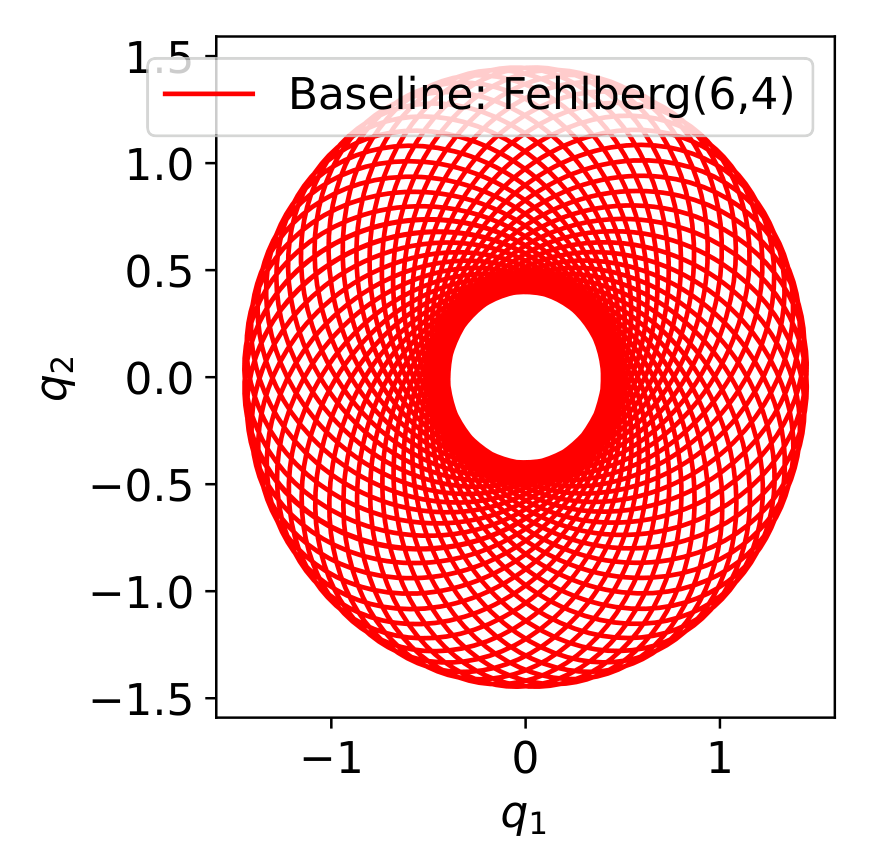

<!-- Generated by build_publications.py; do not edit by hand. -->

```{=html}
<div class="paper-info">

<p class="paper-venue"><span class="pub-journal">Journal of Scientific Computing</span>, 97(1):4 (2023)</p>
<p class="pub-links"><a href="https://doi.org/10.1007/s10915-023-02312-4">Published version</a> | <a href="https://arxiv.org/abs/2302.05235">arXiv version</a></p>
<div style="clear:both"></div>
</div>
```

## Abstract

We generalize the idea of relaxation time stepping methods in order to preserve multiple nonlinear conserved quantities of a dynamical system by projecting along directions defined by multiple time stepping algorithms. Similar to the directional projection method of Calvo et. al., we use embedded Runge-Kutta methods to facilitate this in a computationally efficient manner. Proof of the accuracy of the modified RK methods and the existence of valid relaxation parameters are given, under some restrictions. Among other examples, we apply this technique to Implicit-Explicit Runge-Kutta time integration for the Korteweg-de Vries equation and investigate the feasibility and effect of conserving multiple invariants for multi-soliton solutions.

<p class="abstract-source">Abstract of the arXiv version, <a href="https://arxiv.org/abs/2302.05235">arXiv:2302.05235</a>.</p>

## Code and data

Reproducibility repository: <https://github.com/abhibsws/Multiple_Relaxation_RK_Methods>
