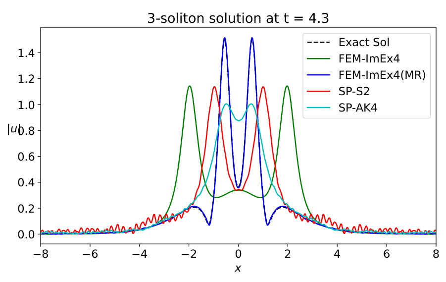

<!-- Generated by build_publications.py; do not edit by hand. -->

```{=html}
<div class="paper-info">

<p class="paper-venue"><span class="pub-journal">SIAM Journal on Scientific Computing</span>, 46(6):A3827--A3848 (2024)</p>
<p class="pub-links"><a href="https://doi.org/10.1137/23M1598118">Published version</a> | <a href="https://arxiv.org/abs/2309.02324">arXiv version</a></p>
<div style="clear:both"></div>
</div>
```

## Abstract

The nonlinear Schrödinger (NLS) equation possesses an infinite hierarchy of conserved densities and the numerical preservation of some of these quantities is critical for accurate long-time simulations, particularly for multi-soliton solutions. We propose an essentially explicit discretization that conserves one or two of these conserved quantities by combining higher-order Implicit-Explicit (ImEx) Runge-Kutta time integrators with the relaxation technique and adaptive step size control. We show through numerical tests that our mass-conserving method is much more efficient and accurate than the widely-used 2nd-order time-splitting pseudospectral approach. Compared to higher-order operator splitting, it gives similar results in general and significantly better results near the semi-classical limit. Furthermore, for some problems adaptive time stepping provides a dramatic reduction in cost without sacrificing accuracy. We also propose a full discretization that conserves both mass and energy by using a conservative finite element spatial discretization and multiple relaxation in time. Our results suggest that this method provides a qualitative improvement in long-time error growth for multi-soliton solutions.

<p class="abstract-source">Abstract of the arXiv version, <a href="https://arxiv.org/abs/2309.02324">arXiv:2309.02324</a>.</p>

## Code and data

Reproducibility repository: <https://github.com/abhibsws/Multiple_Relaxation_NLS>
