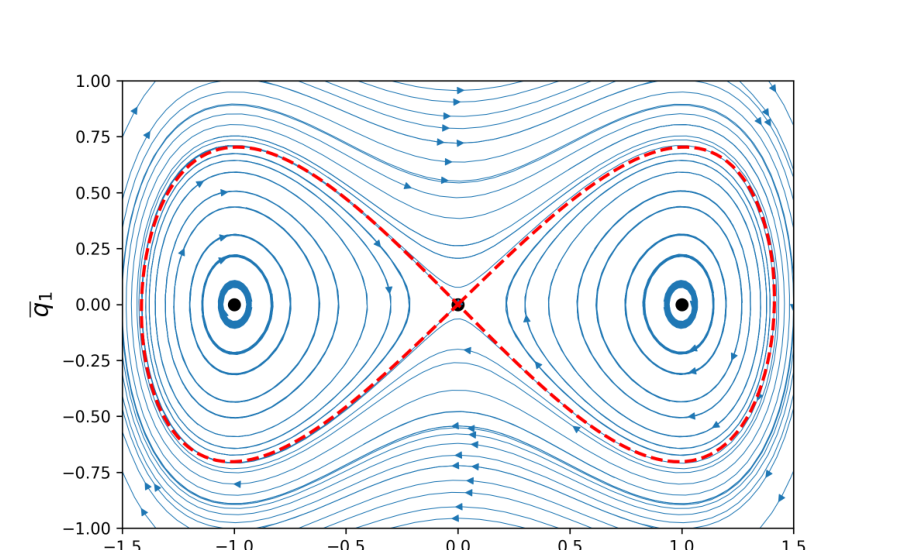

<!-- Generated by build_publications.py; do not edit by hand. -->

```{=html}
<div class="paper-info">

<p class="paper-venue"><span class="pub-journal">Studies in Applied Mathematics</span>, 155(4):e70129 (2025)</p>
<p class="pub-links"><a href="https://doi.org/10.1111/sapm.70129">Published version</a> | <a href="https://arxiv.org/abs/2505.21424">arXiv version</a></p>
<div style="clear:both"></div>
</div>
```

## Abstract

We study a first-order hyperbolic approximation of the nonlinear Schrödinger (NLS) equation. We show that the system is strictly hyperbolic and possesses a modified Hamiltonian structure, along with at least three conserved quantities that approximate those of NLS. We provide families of explicit standing-wave solutions to the hyperbolic system, which are shown to converge uniformly to ground-state solutions of NLS in the relaxation limit. The system is formally equivalent to NLS in the relaxation limit, and we develop asymptotic preserving discretizations that tend to a consistent discretization of NLS in that limit, while also conserving mass. Examples for both the focusing and defocusing regimes demonstrate that the numerical discretization provides an accurate approximation of the NLS solution.

<p class="abstract-source">Abstract of the arXiv version, <a href="https://arxiv.org/abs/2505.21424">arXiv:2505.21424</a>.</p>

## Code and data

Reproducibility repository: <https://github.com/ketch/2025_NLSH_reproducibility>
